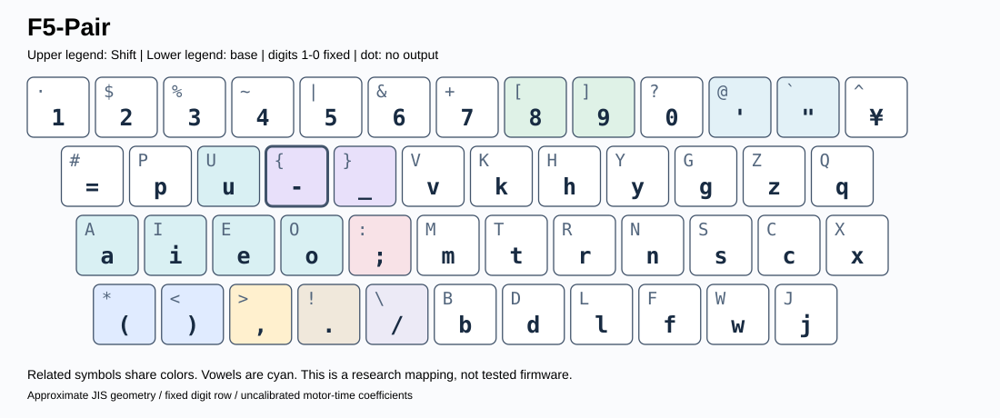

# NOVA — 日本語・英語・コードのキーボード配列研究

<!-- NOVA-PAPER:START -->
## 採用配列と論文

**タイピングゲームGALACTYPEの採用配列はNOVA F5-Pair（内部ID：F5-Balance-mixed）です。** 採用方針の記録であり、ゲーム実装済み・実測効果検証済みという意味ではありません。

| 論文 | DOCX | PDF |
|:--|:--|:--|
| 日本語 | [編集用](papers/nova_f5_pair/nova_f5_pair_ja.docx) | [閲覧用](papers/nova_f5_pair/nova_f5_pair_ja.pdf) |
| English | [Editable](papers/nova_f5_pair/nova_f5_pair_en.docx) | [Read](papers/nova_f5_pair/nova_f5_pair_en.pdf) |

[論文の概要・原稿・再生成手順](papers/nova_f5_pair/README.md)。本文と付録に研究経緯、運動モデル、Shift・記号ペア制約、探索、限界、全30配列×14評価群のKLA-main値をまとめています。

**件数の監査訂正：** 設計上の144元文のうち保存文書に存在するのは142文でした。最終統計は学習94文・検証24文・テスト24文です。従来の96/24/24は名目上の説明値であり、文字数・コーパス・配列・性能値は変更していません。
<!-- NOVA-PAPER:END -->

**最新：F5 / 記号ペア制約 / 2026-10-31 / 研究用プロトタイプ**

数字1〜0を固定し、指×段×内外側とShift操作を考慮して探索した配列です。関連記号は左右隣接または同一キーの通常面／Shift面に揃えます。**速度は未校正の運動モデルによる推定で、実測WPM・学習しやすさは未検証です。**

[最新F5レポート](docs/f5/report.md) · [ブラウザ入口](docs/index.html) · [再現手順](docs/f5/reproduction.md) · [F4自由配置](docs/f4/report.md) · [実験履歴](docs/history/README.md)

## まず見る4案

| 候補 | 狙い | 通常面・Shift面 |
|:--|:--|:--|
| **F5-Pair** | 日英・コード兼用。9ペアを左右隣接または同一キーに配置 | [キー図](diagrams/f5/pair.svg) |
| **F5-Code** | コード比率を高くしたペア制約案 | [キー図](diagrams/f5/code.svg) |
| **F5-Shift** | 全9ペアを同一キーの通常面／Shift面に統一 | [キー図](diagrams/f5/shift.svg) |
| **F5-Grid** | 括弧を2×2ブロック、残り5ペアを同一キーに配置 | [キー図](diagrams/f5/grid.svg) |



上側がShift面、下側が通常面です。[4案一覧](diagrams/f5/overview.svg)・[全キーJSON](layouts/f5/full_layers.json)。QMK/VIAへ直接書き込める設定ではありません。

対象は `()` `[]` `{}` `<>` `;:` 単引用符／二重引用符、カンマ／ピリオド、ハイフン／アンダースコア、スラッシュ／バックスラッシュの9組です。括弧の開閉順序も固定します。Gridでは通常面`[ ]`とShift面`{ }`、通常面`( )`とShift面`< >`を2キーずつのブロックにします。

## 同じF4モデルでの推定速度

| 配列 | 日本語test | 長音符多め | 英語test | コードtest |
|:--|--:|--:|--:|--:|
| QWERTY | +0.00% | +0.00% | +0.00% | +0.00% |
| 大西（JIS近似） | +14.53% | +14.41% | +8.70% | +5.24% |
| F4-Balance | +16.00% | +16.27% | +10.96% | +10.78% |
| F4-Code | +15.79% | +15.44% | +10.52% | +11.47% |
| F5-Pair | +16.00% | +15.99% | +10.81% | +10.61% |
| F5-Code | +15.88% | +15.76% | +10.41% | +11.12% |
| F5-Shift | +14.84% | +15.20% | +9.45% | +9.02% |
| F5-Grid | +14.78% | +15.14% | +9.42% | +9.33% |

`+10%`はモデル上の速度1.10倍です。F5-Pairのコード追加所要時間は自由配置F4-Balanceから約0.15%増える一方、9ペアの位置規則をすべて満たします。記憶時間の改善を実測したわけではありません。KLA点とは別指標です。

## KLA：今回の一式

<!-- KLA-ALL:START -->
### 全30配列のKLA-main近似（F4・F5を同一条件で再計算）

F4の24配列とF5の23配列を、共通配列の重複を除いて**30配列**として掲載します。F4の記号だけを変えた対照実験、長音符の左右制約、F5-JP／F5-Grid-Codeも省略していません。表示名と内部IDを併記し、結果CSVとの対応を固定しています。

評価文字数：JP/test=1,301文字、JP/loanword=2,733文字、EN/test=1,208文字、CODE/test=76,876文字。日本語testは文単位で分離した24文、長音符多めは既出の6診断課題、英文は2課題、コードは7言語の別ファイルです。すでに結果を見たデータを含み、新たな盲検評価ではありません。

| 配列 | 日本語test | 長音符多め | 英語test | コードtest |
|:--|--:|--:|--:|--:|
| QWERTY | 39.16 | 38.02 | 53.25 | 42.07 |
| Dvorak | 49.72 | 50.50 | 68.60 | 53.60 |
| Colemak | 61.05 | 59.10 | 70.68 | 54.53 |
| Workman | 60.85 | 58.23 | 68.76 | 51.69 |
| 大西 | 74.96 | 73.22 | 65.59 | 53.71 |
| Nova-JP | 77.85 | 71.23 | 62.20 | 52.13 |
| Nova-Hybrid | 72.41 | 66.06 | 67.30 | 56.15 |
| Nova-Dev | 66.32 | 63.24 | 64.44 | 53.35 |
| Nova-Ctrl | 72.27 | 64.30 | 67.42 | 54.74 |
| Nova-F3-JP | 77.08 | 72.84 | 66.70 | 53.92 |
| Nova-F3-Balance | 74.01 | 69.57 | 68.94 | 56.11 |
| Nova-F3-Code | 72.26 | 67.71 | 65.91 | 56.24 |
| Nova-F3-Ctrl | 72.31 | 70.23 | 67.01 | 55.52 |
| F4-Balance-free | 74.77 | 71.38 | 68.68 | 61.48 |
| F4-Balance `F4-Balance-left` | 75.28 | 71.67 | 70.60 | 61.89 |
| F4-Balance-R `F4-Balance-right` | 72.71 | 68.29 | 70.94 | 62.03 |
| F4-Balance-shift-only | 74.01 | 69.57 | 69.02 | 58.86 |
| F4-Balance-symbols-only | 74.01 | 70.64 | 68.31 | 57.54 |
| F4-Code `F4-Code-free` | 74.49 | 70.94 | 68.64 | 62.32 |
| F4-Code-right | 75.79 | 72.05 | 68.79 | 61.67 |
| F4-JP `F4-JP-free` | 74.56 | 69.51 | 63.40 | 58.18 |
| F4-JP-left | 74.72 | 70.14 | 63.63 | 57.78 |
| F4-JP-right | 76.71 | 72.13 | 66.88 | 58.63 |
| QWERTY-ShiftDigitsExact | 39.16 | 38.02 | 53.23 | 41.68 |
| F5-Grid `F5-Balance-grid` | 72.81 | 68.87 | 68.37 | 61.30 |
| F5-Pair `F5-Balance-mixed` | 72.82 | 70.64 | 72.93 | 62.00 |
| F5-Shift `F5-Balance-shift` | 75.87 | 72.62 | 66.50 | 61.64 |
| F5-Grid-Code `F5-Code-grid` | 74.71 | 71.75 | 65.62 | 60.39 |
| F5-Code `F5-Code-mixed` | 72.07 | 68.12 | 69.26 | 62.36 |
| F5-JP `F5-JP-mixed` | 77.13 | 72.86 | 63.31 | 57.19 |

<details><summary><strong>日本語：生活文・業務文・技術文の内訳（全30配列）</strong></summary>

| 配列 | 生活文test | 業務文test | 技術文test |
|:--|--:|--:|--:|
| QWERTY | 38.98 | 36.96 | 41.45 |
| Dvorak | 50.67 | 45.74 | 52.72 |
| Colemak | 59.62 | 59.45 | 63.63 |
| Workman | 57.92 | 59.74 | 64.49 |
| 大西 | 76.19 | 72.93 | 75.44 |
| Nova-JP | 77.41 | 76.09 | 79.96 |
| Nova-Hybrid | 73.14 | 71.07 | 72.62 |
| Nova-Dev | 66.91 | 65.82 | 66.28 |
| Nova-Ctrl | 73.41 | 70.39 | 73.07 |
| Nova-F3-JP | 77.88 | 73.23 | 80.09 |
| Nova-F3-Balance | 74.78 | 72.54 | 74.68 |
| Nova-F3-Code | 73.30 | 69.96 | 73.55 |
| Nova-F3-Ctrl | 73.43 | 69.57 | 73.95 |
| F4-Balance-free | 75.56 | 73.65 | 75.14 |
| F4-Balance `F4-Balance-left` | 75.23 | 74.08 | 76.22 |
| F4-Balance-R `F4-Balance-right` | 73.14 | 71.67 | 73.06 |
| F4-Balance-shift-only | 74.78 | 72.54 | 74.68 |
| F4-Balance-symbols-only | 74.78 | 72.54 | 74.68 |
| F4-Code `F4-Code-free` | 75.92 | 72.28 | 74.92 |
| F4-Code-right | 76.45 | 74.55 | 76.14 |
| F4-JP `F4-JP-free` | 73.89 | 74.23 | 75.47 |
| F4-JP-left | 73.96 | 74.83 | 75.30 |
| F4-JP-right | 75.58 | 75.63 | 78.75 |
| QWERTY-ShiftDigitsExact | 38.98 | 36.96 | 41.45 |
| F5-Grid `F5-Balance-grid` | 73.65 | 71.97 | 72.62 |
| F5-Pair `F5-Balance-mixed` | 72.89 | 71.48 | 73.79 |
| F5-Shift `F5-Balance-shift` | 76.91 | 74.87 | 75.65 |
| F5-Grid-Code `F5-Code-grid` | 76.36 | 72.19 | 75.67 |
| F5-Code `F5-Code-mixed` | 73.19 | 70.11 | 72.94 |
| F5-JP `F5-JP-mixed` | 76.54 | 75.30 | 79.44 |

</details>

<details><summary><strong>OSS：7言語別KLA-main近似（全30配列）</strong></summary>

| 配列 | Python | JavaScript | TypeScript | Go | C | C++ | Java |
|:--|--:|--:|--:|--:|--:|--:|--:|
| QWERTY | 46.44 | 44.13 | 42.58 | 39.61 | 38.46 | 41.64 | 40.09 |
| Dvorak | 54.32 | 56.13 | 56.32 | 52.95 | 47.94 | 51.24 | 59.26 |
| Colemak | 61.21 | 53.95 | 52.28 | 55.42 | 50.02 | 52.87 | 57.14 |
| Workman | 53.23 | 54.45 | 52.86 | 51.81 | 46.12 | 50.66 | 53.17 |
| 大西 | 56.23 | 53.65 | 55.60 | 51.41 | 50.74 | 51.59 | 60.26 |
| Nova-JP | 52.63 | 56.50 | 52.74 | 49.26 | 48.63 | 50.80 | 56.53 |
| Nova-Hybrid | 56.26 | 55.79 | 58.77 | 54.84 | 53.35 | 55.24 | 61.66 |
| Nova-Dev | 54.55 | 55.86 | 53.02 | 52.26 | 49.44 | 52.65 | 58.09 |
| Nova-Ctrl | 55.24 | 56.22 | 56.02 | 53.80 | 51.43 | 53.88 | 58.31 |
| Nova-F3-JP | 54.66 | 54.15 | 55.93 | 51.61 | 52.92 | 52.12 | 58.21 |
| Nova-F3-Balance | 56.86 | 54.72 | 58.67 | 54.85 | 53.12 | 55.30 | 62.86 |
| Nova-F3-Code | 57.68 | 57.10 | 58.16 | 53.96 | 52.65 | 55.49 | 61.25 |
| Nova-F3-Ctrl | 58.09 | 56.99 | 56.45 | 53.15 | 52.34 | 54.39 | 58.86 |
| F4-Balance-free | 62.67 | 61.71 | 63.86 | 60.81 | 58.83 | 60.22 | 62.44 |
| F4-Balance `F4-Balance-left` | 64.13 | 63.81 | 62.58 | 61.85 | 59.48 | 59.68 | 60.55 |
| F4-Balance-R `F4-Balance-right` | 64.15 | 62.74 | 63.36 | 61.20 | 60.02 | 60.28 | 62.25 |
| F4-Balance-shift-only | 59.35 | 58.81 | 61.30 | 57.37 | 55.89 | 58.08 | 63.70 |
| F4-Balance-symbols-only | 56.32 | 57.49 | 60.67 | 57.05 | 54.47 | 56.69 | 62.94 |
| F4-Code `F4-Code-free` | 65.00 | 61.51 | 63.78 | 62.35 | 60.89 | 59.48 | 63.57 |
| F4-Code-right | 62.82 | 61.90 | 64.08 | 61.14 | 58.96 | 60.72 | 61.72 |
| F4-JP `F4-JP-free` | 59.62 | 59.53 | 58.97 | 55.78 | 57.40 | 57.25 | 58.63 |
| F4-JP-left | 59.12 | 59.99 | 57.73 | 56.89 | 56.56 | 56.44 | 56.73 |
| F4-JP-right | 61.26 | 59.55 | 58.65 | 57.81 | 57.14 | 56.10 | 60.94 |
| QWERTY-ShiftDigitsExact | 46.13 | 42.68 | 42.52 | 38.94 | 38.34 | 41.72 | 40.15 |
| F5-Grid `F5-Balance-grid` | 62.79 | 61.86 | 63.32 | 60.27 | 58.35 | 60.22 | 62.80 |
| F5-Pair `F5-Balance-mixed` | 62.99 | 62.93 | 63.31 | 61.79 | 59.76 | 60.95 | 61.69 |
| F5-Shift `F5-Balance-shift` | 62.59 | 62.50 | 63.58 | 61.24 | 59.20 | 60.90 | 60.25 |
| F5-Grid-Code `F5-Code-grid` | 63.03 | 60.24 | 62.11 | 58.77 | 58.51 | 59.38 | 60.16 |
| F5-Code `F5-Code-mixed` | 65.13 | 64.10 | 62.68 | 61.72 | 59.59 | 60.11 | 63.45 |
| F5-JP `F5-JP-mixed` | 59.43 | 59.42 | 57.66 | 55.25 | 55.68 | 55.39 | 56.97 |

</details>

コード集計は言語ごとのKLA点の単純平均ではなく、全対象ファイルの文字・連続文字統計から再計算しています。今回のF4/F5には旧実験のRustを合算していません。

**Patorjk公式サイトを直接実行したスコアではありません。** KLA-mainは主文字キーの移動距離33%、指配分33%、異鍵同指17%、同手連打17%の近似です。Shift小指は運動時間モデルに含み、KLA-mainには含めません。指別の仮の時間コストや記憶しやすさもKLA点へ加算していません。速度改善率とは別指標です。旧配列は同じJIS近似に載せ替えた参照版です。

[全30配列・14評価群のKLA値CSV](results/kla_all.csv) · [F4の全指標](results/v4/scores.csv) · [F5の全指標](results/v5/scores.csv)。各表は保存CSVから自動生成し、`python tools/check_readme.py`で一致を検査できます。
<!-- KLA-ALL:END -->

## 再現と検算

```bash
python -m pip install -r requirements-v4.txt
python tools/check_f4.py
python tools/check_f5.py
python tools/check_readme.py
python -m unittest discover -s tests -p 'test_optimize_v[45].py' -v
```

F4の768ケース、F5の736ケースを凍結統計から再計算します。検算は一時コピーを使い保存CSVを上書きしません。**通常CIは探索を実行せず検算だけ**です。再探索は[別手順](docs/f5/reproduction.md)。F4は6,400万提案、F5は3,840万提案の焼きなまし法で、全配置の網羅や大域最適性の証明ではありません。

## 資料の整理

| 内容 | 入口 |
|:--|:--|
| 最新・過去の報告 | [docs](docs/README.md) |
| 全キー定義 | [layouts](layouts/README.md) |
| キーボード図 | [diagrams](diagrams/README.md) |
| コーパス・凍結統計 | [data](data/README.md) |
| スコア・探索ログ・係数感度 | [results](results/README.md) |
| 計算コード | [src](src/README.md) |

F4/F5を版別ディレクトリに分離し、旧成果は削除せず履歴に残しました。OSSの本文は同梱せず、出典と文字・連続文字の集計を保存しています。公開用の再探索ログには実行環境に依存する新しい所要時間が記録されますが、配列定義と数値結果は元の凍結成果物と照合しています。IME・補完・誤打鍵・疲労・学習時間・実機マッピングは別途検証が必要です。[LICENSE](LICENSE)
