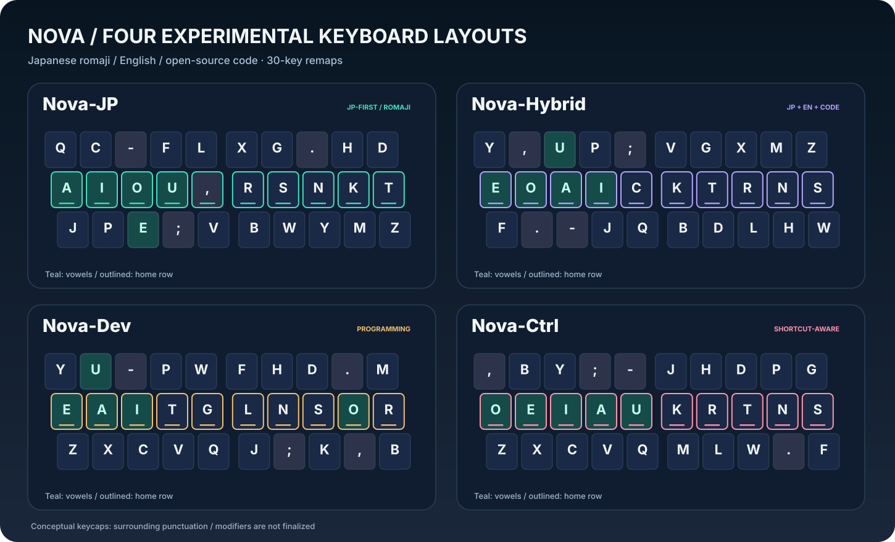
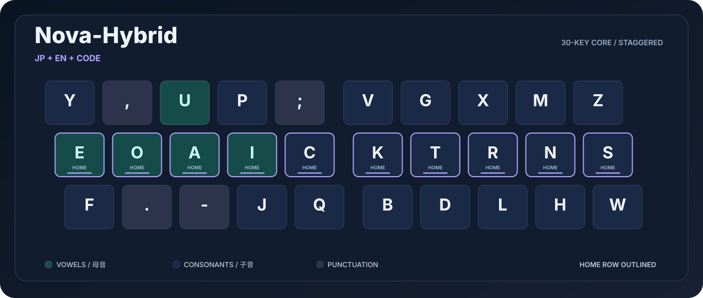
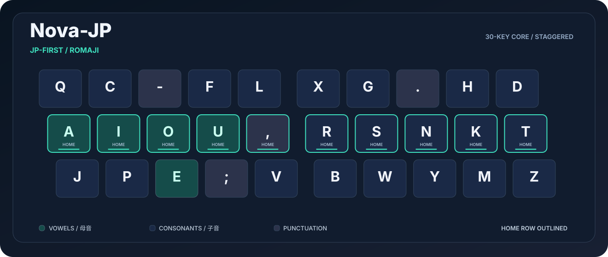
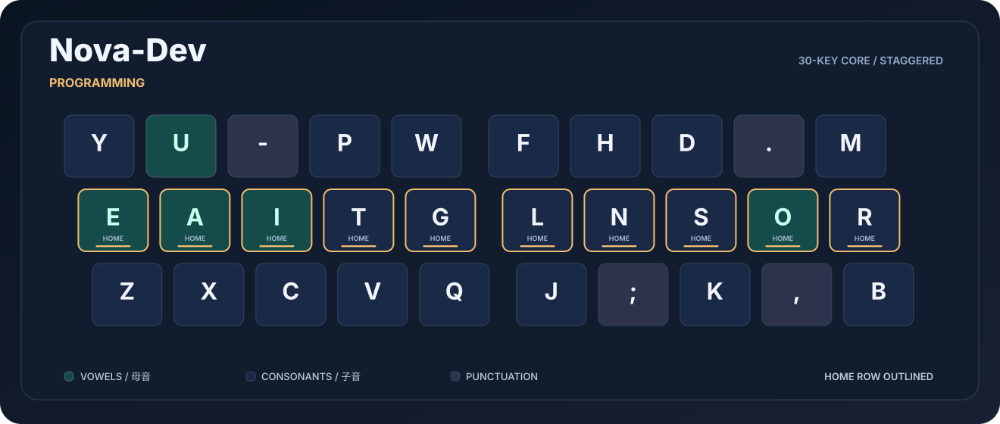
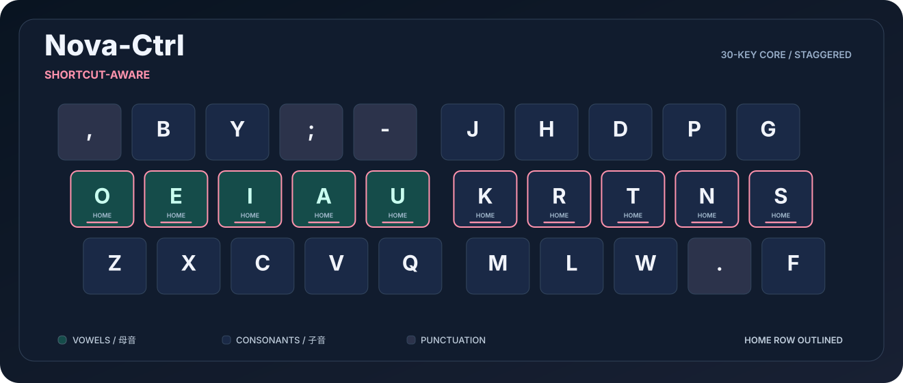

# NOVA — 日本語・英語・コーディング向けキーボード配列の統計設計

**2026-10-31 / 研究用プロトタイプ** — 日本語ローマ字入力、英語、複数言語の OSS ソースコードを同一の打鍵時間モデルで比較した配列設計プロジェクトです。**実測 WPM ではなく、仮定した運動モデルによるシミュレーション**です。



## 配列の候補

| 候補 | 狙い | 上段 | ホーム段 | 下段 | 図 |
|:--|:--|:--|:--|:--|:--|
| **Nova-JP** | 日本語ローマ字を最優先 | `QC-FLXG.HD` | `AIOU,RSNKT` | `JPE;VBWYMZ` | [SVG](diagrams/nova-jp.svg) |
| **Nova-Hybrid** | 日本語・英語・コードの総合バランス | `Y,UP;VGXMZ` | `EOAICKTRNS` | `F.-JQBDLHW` | [SVG](diagrams/nova-hybrid.svg) |
| **Nova-Dev** | コード寄り、`ZXCV` を維持 | `YU-PWFHD.M` | `EAITGLNSOR` | `ZXCVQJ;K,B` | [SVG](diagrams/nova-dev.svg) |
| **Nova-Ctrl** | `ZXCV` 維持、日英コードの妥協点 | `,BY;-JHDPG` | `OEIAUKRTNS` | `ZXCVQMLW.F` | [SVG](diagrams/nova-ctrl.svg) |

### 推奨候補：Nova-Hybrid



**図の読み方**：水色のキーは母音、縁取りされた中央段がホーム段です。主にキー中心30個（3段×10キー）の文字位置だけを最適化しています。数字列、修飾キー、JIS固有の記号キー配置、IME変換操作、Shift側レイヤー、実装方法は完成していません。**この図はそのまま利用できるQMK/VIA/OS用キーマップではありません。**

<details><summary><strong>Nova-JP の図を見る</strong></summary>


</details>

<details><summary><strong>Nova-Dev の図を見る</strong></summary>


</details>

<details><summary><strong>Nova-Ctrl の図を見る</strong></summary>


</details>

既存配列の図： [QWERTY](diagrams/qwerty.svg) / [Dvorak](diagrams/dvorak.svg) / [Colemak](diagrams/colemak.svg) / [Workman](diagrams/workman.svg) / [大西](diagrams/onishi.svg)。定義はすべて [`layouts/layouts.json`](layouts/layouts.json) に収録しています。

## 性能比較：QWERTY比のモデル上の速度増加

| 配列 | 日本語 | 英語 | ローカルOSSコード | 未使用の外部OSS |
|:--|--:|--:|--:|--:|
| QWERTY | 0% | 0% | 0% | 0% |
| Dvorak | +9.94% | +8.53% | +6.13% | +6.07% |
| Colemak | +11.64% | **+10.05%** | +6.48% | +6.63% |
| Workman | +11.88% | +8.87% | +5.58% | +5.34% |
| 大西 | +14.85% | +8.36% | +6.30% | +5.94% |
| **Nova-JP** | **+17.25%** | +5.76% | +5.29% | +5.17% |
| **Nova-Hybrid** | +15.20% | +9.93% | **+7.95%** | **+7.88%** |
| **Nova-Dev** | +13.72% | +9.43% | +7.65% | +7.18% |
| **Nova-Ctrl** | +14.89% | +9.39% | +7.50% | +7.40% |

「+15.20%」は時間削減15.2%ではなく、**予測速度が約1.152倍**（時間は約13.2%削減）という意味です。計算式：`100 × (T_QWERTY / T_layout - 1)`。各配列を等しく習得したと仮定しています。

日本語に最適化すると英語・コードでは不利になる可能性があり、**今回のコーパスと係数では Nova-Hybrid が最もバランスの良い候補**です。大西との差は小さいため実際の配列優劣が確立されたわけではありません。

## KLA型スコア（0〜100点）

[Patorjk Keyboard Layout Analyzer（KLA）](https://patorjk.com/keyboard-layout-analyzer/#/results) の公開アルゴリズムを参考に再実装した、**同じ課題を各配列で入力した場合の近似スコア**です。**高いほど有利**です。これは **KLA公式サイトで直接採点した値ではなく**、本リポジトリで定義したキー座標・指割当て・記号処理に基づく試算です。

| 配列 | 日本語（2,749打鍵） | 英語（3,620字） | OSSコード（157,233字） |
|:--|--:|--:|--:|
| QWERTY | 38.40 | 53.21 | 41.77 |
| Dvorak | 53.88 | 69.11 | 55.39 |
| Colemak | 59.25 | **71.41** | 54.81 |
| Workman | 61.25 | 68.30 | 52.36 |
| 大西 | 76.12 | 66.48 | 55.07 |
| **Nova-JP** | **76.59** | 62.70 | 53.85 |
| **Nova-Hybrid** | 71.91 | 67.72 | **57.66** |
| **Nova-Dev** | 64.59 | 65.85 | 55.54 |
| **Nova-Ctrl** | 72.04 | 67.92 | 56.63 |

- **日本語：Nova-JP** が76.59点で最高。大西（76.12点）との差は小さく、他の文章でも同順位になるとは限りません。
- **英語：Colemak** が71.41点で最高。
- **コード：Nova-Hybrid** が57.66点で最高。記号・Shift・数字列の処理は簡略化しています。

評価の構成比は **移動距離33%＋指の使用分布33%＋異なるキーでの同指連打17%＋同じ手での連打17%** です。これらの重みは**打鍵時間モデル（上表の速度増加率）とは別の評価**であり、KLAスコアから入力速度の増加率を直接求めることはできません。元データは [`data/local_summary.csv`](data/local_summary.csv) の `KLA_approx` 列、計算処理は [`src/benchmark.py`](src/benchmark.py) にあります。

## ブラウザで比較する

**[`docs/index.html`](docs/index.html)** はオフラインで動く単一HTMLレポートです。リポジトリをダウンロードし、ブラウザで開いてください（GitHubのファイル表示画面では実行されません）。日本語・英語・コードの重み調整、キー図、KLA型評価、感度分析、ローマ字/英語/ASCIIコードの自由入力試算が可能です。漢字かな交じりの日本語を自動ローマ字変換する機能はありません。

## ベンチマーク対象

- **日本語**：自作6課題・計2,749ローマ字打鍵。固定した読みを `し=si` / `ち=ti` / `つ=tu` 等に統一しています。日本語入力中のかな漢字変換、候補選択、Space / Enterの追加操作は未考慮です。
- **英語**：自作6課題・計3,620字（空白など含む）。小規模課題なので一般的な英文全体の統計的代表性は保証しません。
- **ローカルOSSコード**：Python、JavaScript、TypeScript、Go、C、C++、Javaの7言語・14ソース断片・計157,233字。複数のオープンソース実装を対象にしました。Rustはこの最適化用集合には含みません。
- **外部OSS検証**：学習・最適化に使用していない別の公開ソース8言語・8ファイル・計76,803字（Python, JavaScript, TypeScript, Rust, Go, C, C++, Java）。取得時のBlob SHAと行範囲を [`data/external_oss_sources.json`](data/external_oss_sources.json) に保存。外部データには C/C++ のヘッダー、コメント、記号列などが含まれます。

外部コーパス： [CPython](https://github.com/python/cpython) / [noVNC](https://github.com/novnc/noVNC) / [TypeScript](https://github.com/microsoft/TypeScript) / [Rust](https://github.com/rust-lang/rust) / [Go](https://github.com/golang/go) / [SQLite](https://github.com/sqlite/sqlite) / [fmt](https://github.com/fmtlib/fmt) / [Guava](https://github.com/google/guava)。OSSのソース本文は再配布せず、**文字・連続文字の集計結果**とファイル参照のみ公開しています。

## 打鍵時間モデルとPatorjk KLA型スコア

- 3段×10キーの段差付きキー中心座標、キー間隔19.05mm、ホーム段（4指×両手）を仮定。
- 1打鍵の基準118ms、Shiftが必要な文字に+38ms。
- **異なるキーを同じ指で連打**したときの追加時間：`36 + 56×log₂(1+d) + 6d` ms。ここで `d` はキー間隔単位の距離。同一キー連打なら+23ms。
- 異なる指への遷移には、ホームから次のキーへの距離×19ms、前のキーからホームへの戻り距離×9msを加算。同じ手で異なる指を使う場合は+8ms。
- 数字・記号とShiftの座標は簡略化しており、JIS実機で厳密に測ったものではありません。
- **KLA型スコア**は [Patorjk Keyboard Layout Analyzer](https://patorjk.com/keyboard-layout-analyzer/#/results) の [公開実装](https://github.com/patorjk/keyboard-layout-analyzer/blob/master/js/analyzer.js) を参考に、距離33%・指配分33%・異鍵同指連打17%・同手連打17%で近似再実装しています。**オリジナルサイトのブラウザで直接採点した結果ではありません。**

係数は経験的な仮定であり、個人の打鍵時間、習熟、疲労、ミスタイプ、実際の手の姿勢を測ったものではありません。係数を0.5～3倍に変化させた結果を [`data/sensitivity.csv`](data/sensitivity.csv) に保存しました。

## 再現手順（Python 3.10以降、標準ライブラリのみ）

```bash
python src/benchmark.py --check            # 保存済み27ケースと計算を照合
python src/benchmark.py --category CODE    # 全9配列をコードで評価
python src/benchmark.py --text 'def f(x): return x * 2'
python src/generate_diagrams.py           # SVGを再生成
python -m unittest discover -s tests -v   # 回帰テスト
```

`data/aggregates.json` にローマ字/英文/OSSの1文字・2文字連続統計を収録しているため、元ソースを再取得しなくても**同じ集計結果からモデル計算を再現**できます。自作の日本語・英語原稿は [`data/jp_en_corpora.json`](data/jp_en_corpora.json)。外部OSS8ファイルの元データから再検証する場合のみネットワークが必要です：

```bash
python src/benchmark_external.py         # GitHub Public APIから取得（速度制限あり）
python src/benchmark_external.py --only Rust
```

## 研究上の限界と次のステップ

この探索は**局所的なヒューリスティック最適化**であり、数学的な大域最適性を保証しません。ローマ字の綴り・課題の種類・物理キーボード（JIS / ANSI / 分割・列スタッガード）によって評価が変わります。プログラミングでは特に `()[]{}`、`_`、`=`, `;`、ショートカット、補完、Vim操作などを実際のワークフローで検証すべきです。実機使用前に、キーキャップ配置、マッピング（OS/QMK）、日本語IMEとの整合を設計してください。

次の研究では、50万～100万字規模の独立コーパスでの交差検証、指移動の実測時間・誤打鍵率による係数校正、左右の負担・ロール・記号レイヤーを含む多目的最適化を想定しています。

## 構成

```text
README.md                    日本語の要約と配列図
diagrams/                    SVGキー図（9配列＋一覧）
layouts/layouts.json         全配列の物理30キー定義
docs/index.html              インタラクティブ比較レポート
data/local_summary.csv       3カテゴリ・9配列の結果
data/by_document.csv         課題別の指標
data/sensitivity.csv         同指連打係数の感度
data/external_oss.csv        8言語OSSの外部検証
data/external_oss_sources.json 取得先・行範囲・Blob SHA
data/aggregates.json         コーパスの集計済みユニグラム/バイグラム
data/jp_en_corpora.json      自作の日本語・英語課題
src/benchmark.py             標準ライブラリのみの再現コード
src/benchmark_external.py    外部OSS再検証（任意）
src/generate_diagrams.py     SVG再生成
tests/                       回帰テスト
```

© Original modeling/visualizations. See repository [LICENSE](LICENSE). Third-party OSS source is **not bundled**; upstream projects retain their own licenses.
