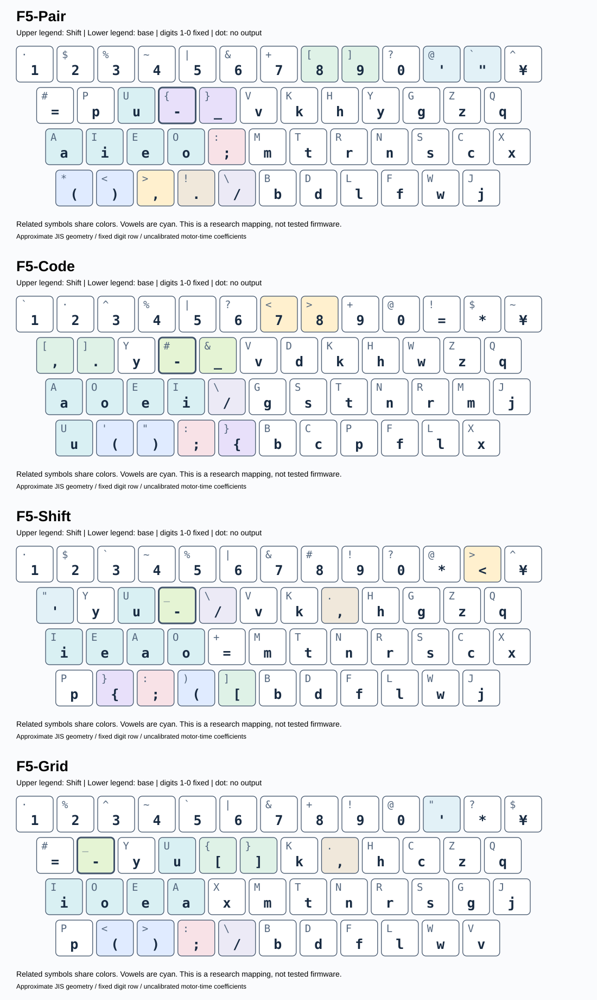

# NOVA F5：配列図・速度・KLA近似

2026-10-31 / 研究用プロトタイプ

記号の9ペアを同段・同面の左右隣接、または同一キーの通常面→Shift面に揃える制約を導入しました。記憶の改善を仮の時間短縮として加算していません。

**KLA-mainはPatorjkの公開式を参考にした主文字キーの近似値です。公式サイトで直接採点した値ではなく、Shift小指の運動は別の時間モデルに含めています。実測WPM・学習時間・開発生産性の予測ではありません。**

[最新README](../../README.md) · [再現手順](reproduction.md) · [全指標CSV](../../results/v5/scores.csv)

## 推定速度増加率・対QWERTY

| 配列 | 日本語test | 長音符多め | 英語test | コードtest |
|:--|--:|--:|--:|--:|
| QWERTY | +0.00% | +0.00% | +0.00% | +0.00% |
| Dvorak | +8.19% | +8.76% | +8.90% | +5.13% |
| Colemak | +12.06% | +11.90% | +10.07% | +6.20% |
| Workman | +11.72% | +10.83% | +9.79% | +5.40% |
| 大西 | +14.53% | +14.41% | +8.70% | +5.24% |
| Nova-JP | +16.93% | +14.70% | +4.30% | +3.48% |
| Nova-Hybrid | +14.90% | +13.77% | +9.67% | +6.51% |
| Nova-Dev | +13.52% | +14.01% | +9.25% | +6.54% |
| Nova-Ctrl | +14.29% | +13.01% | +9.58% | +6.35% |
| Nova-F3-JP | +18.13% | +17.05% | +7.06% | +4.63% |
| Nova-F3-Balance | +15.93% | +15.35% | +10.38% | +6.83% |
| Nova-F3-Code | +15.59% | +15.05% | +10.45% | +7.21% |
| Nova-F3-Ctrl | +15.73% | +15.95% | +10.14% | +6.44% |
| F4-JP-free | +18.14% | +17.15% | +7.10% | +8.61% |
| F4-Balance-left | +16.00% | +16.27% | +10.96% | +10.78% |
| F4-Code-free | +15.79% | +15.44% | +10.52% | +11.47% |
| F4-Balance-right | +16.14% | +15.80% | +10.66% | +11.15% |
| F5-Grid | +14.78% | +15.14% | +9.42% | +9.33% |
| F5-Pair | +16.00% | +15.99% | +10.81% | +10.61% |
| F5-Shift | +14.84% | +15.20% | +9.45% | +9.02% |
| F5-Grid-Code | +14.50% | +14.79% | +9.69% | +9.71% |
| F5-Code | +15.88% | +15.76% | +10.41% | +11.12% |
| F5-JP | +18.24% | +17.17% | +6.38% | +7.96% |

## KLA-main近似・全候補

| 配列 | 日本語test | 長音符多め | 英語test | コードtest |
|:--|--:|--:|--:|--:|
| QWERTY | 39.16 | 38.02 | 53.25 | 42.07 |
| Dvorak | 49.72 | 50.50 | 68.60 | 53.60 |
| Colemak | 61.05 | 59.10 | 70.68 | 54.53 |
| Workman | 60.85 | 58.23 | 68.76 | 51.69 |
| 大西 | 74.96 | 73.22 | 65.59 | 53.71 |
| Nova-JP | 77.85 | 71.23 | 62.20 | 52.13 |
| Nova-Hybrid | 72.41 | 66.06 | 67.30 | 56.15 |
| Nova-Dev | 66.32 | 63.24 | 64.44 | 53.35 |
| Nova-Ctrl | 72.27 | 64.30 | 67.42 | 54.74 |
| Nova-F3-JP | 77.08 | 72.84 | 66.70 | 53.92 |
| Nova-F3-Balance | 74.01 | 69.57 | 68.94 | 56.11 |
| Nova-F3-Code | 72.26 | 67.71 | 65.91 | 56.24 |
| Nova-F3-Ctrl | 72.31 | 70.23 | 67.01 | 55.52 |
| F4-JP-free | 74.56 | 69.51 | 63.40 | 58.18 |
| F4-Balance-left | 75.28 | 71.67 | 70.60 | 61.89 |
| F4-Code-free | 74.49 | 70.94 | 68.64 | 62.32 |
| F4-Balance-right | 72.71 | 68.29 | 70.94 | 62.03 |
| F5-Grid | 72.81 | 68.87 | 68.37 | 61.30 |
| F5-Pair | 72.82 | 70.64 | 72.93 | 62.00 |
| F5-Shift | 75.87 | 72.62 | 66.50 | 61.64 |
| F5-Grid-Code | 74.71 | 71.75 | 65.62 | 60.39 |
| F5-Code | 72.07 | 68.12 | 69.26 | 62.36 |
| F5-JP | 77.13 | 72.86 | 63.31 | 57.19 |

## 日本語の分野別KLA-main

| 配列 | 生活文 | 業務文 | 技術文 |
|:--|--:|--:|--:|
| QWERTY | 38.98 | 36.96 | 41.45 |
| Dvorak | 50.67 | 45.74 | 52.72 |
| Colemak | 59.62 | 59.45 | 63.63 |
| Workman | 57.92 | 59.74 | 64.49 |
| 大西 | 76.19 | 72.93 | 75.44 |
| Nova-JP | 77.41 | 76.09 | 79.96 |
| Nova-Hybrid | 73.14 | 71.07 | 72.62 |
| Nova-Dev | 66.91 | 65.82 | 66.28 |
| Nova-Ctrl | 73.41 | 70.39 | 73.07 |
| Nova-F3-JP | 77.88 | 73.23 | 80.09 |
| Nova-F3-Balance | 74.78 | 72.54 | 74.68 |
| Nova-F3-Code | 73.30 | 69.96 | 73.55 |
| Nova-F3-Ctrl | 73.43 | 69.57 | 73.95 |
| F4-JP-free | 73.89 | 74.23 | 75.47 |
| F4-Balance-left | 75.23 | 74.08 | 76.22 |
| F4-Code-free | 75.92 | 72.28 | 74.92 |
| F4-Balance-right | 73.14 | 71.67 | 73.06 |
| F5-Grid | 73.65 | 71.97 | 72.62 |
| F5-Pair | 72.89 | 71.48 | 73.79 |
| F5-Shift | 76.91 | 74.87 | 75.65 |
| F5-Grid-Code | 76.36 | 72.19 | 75.67 |
| F5-Code | 73.19 | 70.11 | 72.94 |
| F5-JP | 76.54 | 75.30 | 79.44 |

## OSS言語別KLA-main

| 配列 | Python | JavaScript | TypeScript | Go | C | C++ | Java |
|:--|--:|--:|--:|--:|--:|--:|--:|
| QWERTY | 46.44 | 44.13 | 42.58 | 39.61 | 38.46 | 41.64 | 40.09 |
| Dvorak | 54.32 | 56.13 | 56.32 | 52.95 | 47.94 | 51.24 | 59.26 |
| Colemak | 61.21 | 53.95 | 52.28 | 55.42 | 50.02 | 52.87 | 57.14 |
| Workman | 53.23 | 54.45 | 52.86 | 51.81 | 46.12 | 50.66 | 53.17 |
| 大西 | 56.23 | 53.65 | 55.60 | 51.41 | 50.74 | 51.59 | 60.26 |
| Nova-JP | 52.63 | 56.50 | 52.74 | 49.26 | 48.63 | 50.80 | 56.53 |
| Nova-Hybrid | 56.26 | 55.79 | 58.77 | 54.84 | 53.35 | 55.24 | 61.66 |
| Nova-Dev | 54.55 | 55.86 | 53.02 | 52.26 | 49.44 | 52.65 | 58.09 |
| Nova-Ctrl | 55.24 | 56.22 | 56.02 | 53.80 | 51.43 | 53.88 | 58.31 |
| Nova-F3-JP | 54.66 | 54.15 | 55.93 | 51.61 | 52.92 | 52.12 | 58.21 |
| Nova-F3-Balance | 56.86 | 54.72 | 58.67 | 54.85 | 53.12 | 55.30 | 62.86 |
| Nova-F3-Code | 57.68 | 57.10 | 58.16 | 53.96 | 52.65 | 55.49 | 61.25 |
| Nova-F3-Ctrl | 58.09 | 56.99 | 56.45 | 53.15 | 52.34 | 54.39 | 58.86 |
| F4-JP-free | 59.62 | 59.53 | 58.97 | 55.78 | 57.40 | 57.25 | 58.63 |
| F4-Balance-left | 64.13 | 63.81 | 62.58 | 61.85 | 59.48 | 59.68 | 60.55 |
| F4-Code-free | 65.00 | 61.51 | 63.78 | 62.35 | 60.89 | 59.48 | 63.57 |
| F4-Balance-right | 64.15 | 62.74 | 63.36 | 61.20 | 60.02 | 60.28 | 62.25 |
| F5-Grid | 62.79 | 61.86 | 63.32 | 60.27 | 58.35 | 60.22 | 62.80 |
| F5-Pair | 62.99 | 62.93 | 63.31 | 61.79 | 59.76 | 60.95 | 61.69 |
| F5-Shift | 62.59 | 62.50 | 63.58 | 61.24 | 59.20 | 60.90 | 60.25 |
| F5-Grid-Code | 63.03 | 60.24 | 62.11 | 58.77 | 58.51 | 59.38 | 60.16 |
| F5-Code | 65.13 | 64.10 | 62.68 | 61.72 | 59.59 | 60.11 | 63.45 |
| F5-JP | 59.43 | 59.42 | 57.66 | 55.25 | 55.68 | 55.39 | 56.97 |

## 探索

確率的焼きなましの提案38,400,000回、制約を満たして採点14,085,600回、局所改善1,893,732回。重複状態を含み、全配列の網羅・大域最適性の証明ではありません。候補は訓練目的関数で選び、各検証表は固定配置を再評価しています。

## コーパスと検証の範囲

日本語は合成144文をトピック別に文単位分離（train 96文5,104文字、validation 24文1,331文字、test 24文1,301文字）。英語train 2,412文字／test 1,208文字。OSSはPython・JavaScript・TypeScript・Go・C・C++・Javaの別ファイル（train 80,357文字／test 76,876文字）。長音符多め6課題2,733文字など、既に結果を見た診断用データを含むため、新たな盲検評価ではありません。

## モデル

基準118ms、ホームからの距離19ms/キー間隔、戻り9ms/キー間隔、同手異指8ms。同指異鍵は36+56*log2(1+d)+6*d ms。指×段×内外側と数字段の費用、反対側小指によるShift開始・継続・切替・競合を加えます。係数は実測校正前の仮定値です。探索用の負担正則化項は、報告する運動時間の値には含めません。

## 解釈の注意

KLA集計は言語別点数の単純平均ではなく、合算した文字・連続文字統計から算出。F4/F5は同じJIS近似への適応版として既存配列を評価しています。誤打鍵・疲労・IME・補完・ショートカット・学習時間は未計測です。

## 記号の規則

対象は () [] {} <> ;: 単引用符/二重引用符 ,. -_ /バックスラッシュ の9組。Pair/Code/JPは隣接または同一キー、Shiftは全組同一キー、Gridは通常[]・Shift{}と通常()・Shift<>の2×2ブロック、その他5組を同一キーにします。

[係数感度](../../results/v5/sensitivity.csv) · [探索ログ](../../results/v5/search/) · [全キーJSON](../../layouts/f5/full_layers.json)
