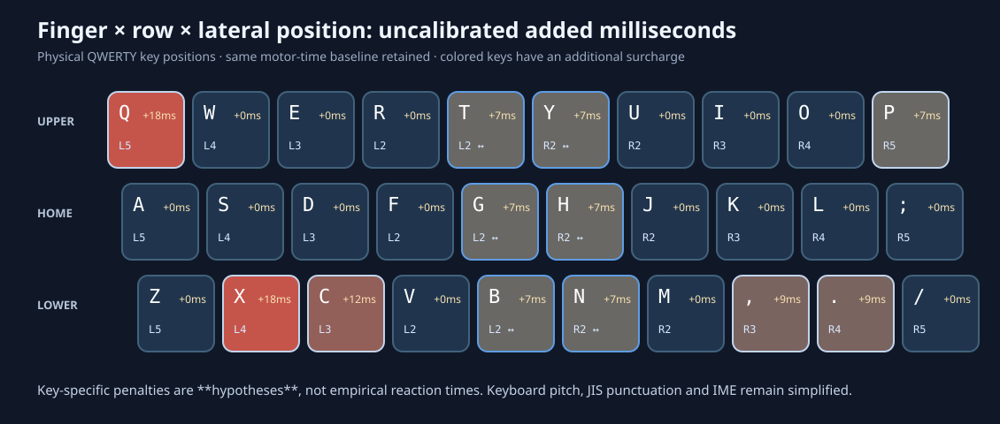

# 指×段×内外側の個人仮説と3分野の合成日本語コーパス（v2）

このファイルは `python src/render_report.py` でCSVから自動生成。**速度は未校正のモデル推定であり、実測WPMではない。** GitHubで公開済みの既存9配列は変更していない。研究用の感度試験である。



## 1. 実装した主観的な打鍵コスト

| 指 | 上段 | 中段 | 下段 |
|:--|--:|--:|--:|
| 左小指 | **+18 ms** | 0 | 0 |
| 左薬指 | 0 | 0 | **+18 ms** |
| 左中指 | 0 | 0 | **+12 ms** |
| 左人差し指 | 0 | 0 | 0 |
| 右人差し指 | 0 | 0 | 0 |
| 右中指 | 0 | 0 | **+9 ms** |
| 右薬指 | 0 | 0 | **+9 ms** |
| 右小指 | **+7 ms** | 0 | 0 |

これはユーザーの主観的な打鍵感覚を仮のミリ秒に割り振ったもので、実験によるフィットではない。すべての打鍵に、旧モデルの移動・同指連打コストを残したまま**追加**している。人差し指の内側コラムは1打鍵+7 ms、他の指の内側+5 ms、小指の外側+10 ms、その他の外側+6 ms（ホーム位置から±0.40キー間隔以内は中立）。数字段に属する周辺キーは+12 ms。さらに同一指で段を上から下・下から上に飛び越える場合+7 ms、同じ指で内側に伸ばす場合+4 ms、外側に伸ばす場合+6 ms。すべて任意設定である。

- 左右の内外はホーム位置から見た**手の中央側／外側**として定義する。中段の人差し指の中央寄りキーは+7 msとなる。
- 片手の小指など、一段の得手不得手だけが確かな条件については、他の段に新たなペナルティを置かず0とした。0 msは「その位置が物理的に全く楽」と主張する値ではない。
- Patorjk/KLA型スコアにはこの新しい非対称コストを**加算しない**。以前と同じKLA近似である。下表の新スコアは打鍵時間モデルの結果であって、KLA点数ではない。
- 前提は中央30キーの行スタッガード、19.05 mmキー間隔、標準ホームキー。数字列や`-`キーの位置はUS風の単純モデルであり、JIS実機、シフト、IME変換、慣れ、誤打鍵、手首移動は未校正。

## 2. 独自生成の3領域コーパス

作者が日本語の文章とかな読みを1文ずつ対応付けて144文を用意し、固定乱数で各トピックから9文を選んで組み合わせた。**48文書といっても144文が重複して登場するため、48個の完全独立した文章サンプルではない。** 実ニュース・BCCWJ・SNS等の標本抽出はしていない。分野ごとに人手作成した文の偏りが残る。

| ドメイン | トピック数 | 文書数 | 日本語文字数 | ローマ字打鍵 | `ー`入力 | 長音符比率 |
|:--|--:|--:|--:|--:|--:|--:|
| 生活文 | 4 | 16 | 3,537 | 7,605 | 100 | 1.31% |
| 業務文 | 4 | 16 | 3,453 | 7,920 | 102 | 1.29% |
| 技術文 | 4 | 16 | 3,598 | 7,958 | 141 | 1.77% |

生活文は買い物と食事／家事と住まい／移動と旅行／連絡と娯楽。業務文は会議と日程／経費と調達／顧客とサポート／運用と安全。技術文はソフトウェア開発／データ分析とAI／電池材料と計測／ネットワークと装置を各4文書ずつ含む。1文書当たり9文、各テーマ12種類の原文から選ぶ。

出典はすべてオリジナルで、[原文＋かな読み＋ローマ字＋出現メタデータ](../data/synthetic_three_domains.json)と[再生成スクリプト](../src/generate_corpus.py)を公開。長音符`ー`は必ず`-`、`し/ち/つ/ふ/じ`は従来と同じ`si/ti/tu/hu/zi`方式。IME変換操作なし。

## 3. 既存9配列の評価（QWERTY比の速度増加率）

3分野は同じキー数でなくても、**各分野の中だけ**で比較している。全配列を等しく習得したと仮定。

| 配列 | 生活文 | 業務文 | 技術文 | 旧モデル・生活文 |
|:--|--:|--:|--:|--:|
| QWERTY | +0.00% | +0.00% | +0.00% | +0.00% |
| Dvorak | +10.22% | +9.74% | +9.83% | +9.72% |
| Colemak | +12.61% | +12.70% | +12.23% | +11.99% |
| Workman | +12.29% | +12.45% | +12.20% | +11.82% |
| 大西 | +15.26% | +15.21% | +15.23% | +14.35% |
| Nova-JP | +16.80% | +17.70% | +16.89% | +16.60% |
| Nova-Hybrid | +15.31% | +15.50% | +15.19% | +15.06% |
| Nova-Dev | +14.12% | +14.35% | +14.19% | +13.66% |
| Nova-Ctrl | +14.53% | +14.91% | +14.13% | +14.34% |

生活文・業務文・技術文のどれでも、今回の係数では**Nova-JPが首位**。ただしモデルは本人の打鍵ログで実測校正されていないため、1〜2ポイントの差を実用上の有意差とみなさない。

## 4. 以前の6課題でも検証

以前に保存された日本語の自作6課題（長音符比率約0.36%）と、別に作った**外来語多めの6課題**（同約4.32%）にも新しいモデルを適用した。後者も真の現代日本語頻度ではない。

| 配列 | 旧6課題（新モデル） | カタカナ増量6課題（新モデル） |
|:--|--:|--:|
| QWERTY | +0.00% | +0.00% |
| Dvorak | +10.36% | +10.65% |
| Colemak | +12.18% | +11.82% |
| Workman | +12.27% | +10.76% |
| 大西 | +15.73% | +14.86% |
| Nova-JP | +17.34% | +15.14% |
| Nova-Hybrid | +15.55% | +14.21% |
| Nova-Dev | +13.98% | +14.45% |
| Nova-Ctrl | +14.76% | +13.45% |

長音符が多いほうではNova-JPと大西の差が縮まりやすい。以前のKLA型近似ではカタカナ増量6課題において大西がNova-JPを上回ったが、今回の追加コストはKLAそのものを変えないため、その順位差はKLA点数上では残る。

## 5. 段別と内外側の感度分析（生活文）

| 条件 | Nova-JP | 大西 | Nova-Hybrid |
|:--|--:|--:|--:|
| 旧モデル（段0、横0） | +16.60% | +14.35% | +15.06% |
| 指×段のみ | +15.68% | +14.54% | +14.34% |
| 内外方向のみ | +17.72% | +15.07% | +16.03% |
| 両方を適用 | +16.80% | +15.26% | +15.31% |
| 両方2倍 | +17.00% | +16.17% | +15.56% |

行コストと横方向のコストで効果が逆向きになる場合がある。現在の主観的係数では首位は変わらないが、**2位・3位の順位は仮定によって変わる**。感度を1変数ずつ切り分けないと「どちらが良いか」の議論に意味がなくなる。

## 6. 評価の限界と次の実験

1. キーごとの手の姿勢に応じた時間を測る。各指・各段で例えば20〜50回ずつ、打鍵速度と誤打鍵率を記録し、主観的な+18,+12,+9,+7 msの仮説を回帰推定する。
2. 同指異鍵2打鍵、上→下と下→上、横移動の内向き／外向きの非対称を検証する。指が予測的に動くことを考慮し、同じテキストでの実際のキー間隔（IKI）を採用する。
3. 実文章から独立に採った生活・業務・技術のコーパスに差し替える。権利・個人情報への配慮を前提としてジャンル比率を公開する。生成した同一文の再利用は避ける。
4. 長音符、文書内の語彙、IMEかな漢字変換キー、JIS配列の数字・記号を含める。新配列の再最適化は**コーパス確定と係数校正の後**に別データで検証する。

関連：[Workmanの設計原則](https://workmanlayout.org/)、[Klein 2026 Engram Study](https://doi.org/10.1080/10447318.2026.2665409)。Engram論文は段移動、同指、横方向への伸び、指の順序などを調べたもので、このリポジトリの加算ミリ秒係数を裏付ける実測値ではない。

## 再現

```bash
python src/generate_corpus.py
python src/benchmark_finger_rows.py --check
python src/render_finger_heatmap.py
python src/render_report.py
python -m unittest discover -s tests -p 'test_finger_rows.py' -v
```

生成されるCSV：`results/finger_rows_v2/summary.csv`、`by_document.csv`、`sensitivity.csv`、`prior_controls.csv`、`key_costs.csv`、`corpus_stats.csv`、`mixture_profiles.csv`。新モデルを入れてもKLA型スコアは`KLA_approx_unchanged`列として引き続き再計算される。
