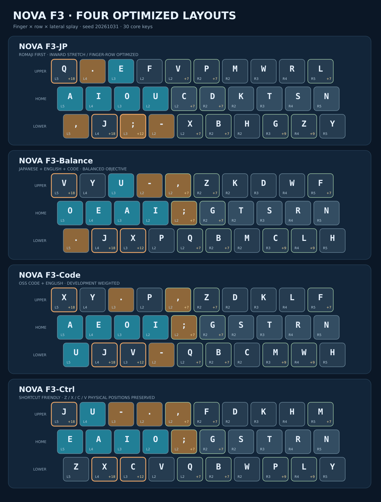

# NOVA F3：指×段×内外側コストを考慮した新キーボード4配列

> 2026-10-31。**研究用のモデル推定であり、実測WPMや疲労の測定ではありません。** KLA型近似スコアはPatorjk公式サイトで直接採点したものではなく、既存の公開式を参考に再実装した値です。局所的な焼きなまし法による最適化であり大域最適性は保証しません。



## 1. 4つの候補と用途

| 候補 | 上段 | 中段 | 下段 | 最適化の用途 |
|:--|:--|:--|:--|:--|
| **Nova-F3-JP** | `Q.EFVPMWRL` | `AIOUCDKTSN` | `,J;-XBHGZY` | 日本語優先 |
| **Nova-F3-Balance** | `VYU-,ZKDWF` | `OEAI;GTSRN` | `.JXPQBMCLH` | 日英・コード兼用 |
| **Nova-F3-Code** | `XY.P,ZDKLF` | `AEOI;GSTRN` | `UJV-QBCMWH` | 開発優先 |
| **Nova-F3-Ctrl** | `JU-.,FDKHM` | `EAIO;GSTRN` | `ZXCVQBWPLY` | Z/X/C/Vを維持 |

各案は中央の3段×10キーに26英字と4記号（`- . , ;`）を配置します。周辺の数字、`/`, `[]`, `=`, Shift等は従来の単純なUS型座標を仮定し、JISキーボード実機には未対応です。**QMK/VIA/OSへ直ちに適用できるキーマップではありません。** F3-Ctrlは、`ZXCV`の4物理キーだけをQWERTYと同じ下段左端に固定しています。

最適化重み（すべて打鍵数で正規化）：日本語優先 `[生活30, 業務30, 技術25, 英語8, コード7]%`；日英兼用 `[18,18,19,23,22]%`；開発優先 `[11,11,13,20,45]%`；ショートカット `[16,18,21,20,25]%`。数値は利用実態を実測した重みではなく、用途別に設定した設計条件です。

## 2. 運動モデル（前回のv2から変更なし）

基準118 ms/打鍵と前後キーの移動時間（異なる指の距離項、同指での直接移動）は維持。そのうえで、仮定したキー姿勢コストを加算します。

| 指 | 上段追加 | 下段追加 |
|:--|--:|--:|
| 左小指 | +18 ms | 0 |
| 左薬指 | 0 | +18 ms |
| 左中指 | 0 | +12 ms |
| 右中指 | 0 | +9 ms |
| 右薬指 | 0 | +9 ms |
| 右小指 | +7 ms | 0 |

さらに人差し指の内側+7 ms、小指の外側+10 ms、その他の指の内側+5 ms・外側+6 ms、同指で上段↔下段+7 ms、同指の内向き遷移+4 ms・外向き遷移+6 ms、数字列+12 msを仮定。内外判定はホームから0.40キー間隔をしきい値としています。**すべて実測ではなく、主観的な打ちにくさの仮説値**です。旧KLA型スコアにこれらの追加コストは反映していません。

最適化目的関数は、v2推定時間に加えて、負荷集中、左右の偏り、ホーム段使用率、同指異鍵連打への小さな正則化を加えています。実装：[モデル](../src/benchmark_finger_rows.py)、[最適化](../src/optimize_v3.py)。

## 3. 探索データと独立性

- **学習日本語**：従来作成した生活・業務・技術の合成文章で、各ドメインのdevelopmentグループ。144文を48文書に再構成したもので、**holdout側の合成文書にも元の同じ文が出現**します。よって合成文書のholdoutは完全な独立検証ではありません。
- **学習英語**：6つの自作英文から日常・研究・ビジネス・歴史の4課題。検証は別の2課題Software/Literature（1,208打鍵）。
- **学習OSS**：Python, JavaScript, TypeScript, Go, C, C++, Javaの各2ソース断片のうち先頭を学習に使用。検証は各言語で**別のソースファイル**を使用（計76,876打鍵）。同一プロジェクトの別ファイルも含まれるので、別プロジェクトへの汎化を保証しません。
- **別原稿での日本語検証**：元の6課題（2,749打鍵）およびカタカナ語を意図的に増やした6課題（2,733打鍵）を学習から除外。いずれも人工的な自作文で、現代日本語のランダムサンプリングではありません。
- **ローマ字規則**：従来に合わせ`si/ti/tu/hu/zi`、長音符`ー`は`-`。IME変換や誤打鍵は未考慮。

コードの元ファイルは著作権のため再配布せず、**文字・連続文字の統計とSHA-256**だけを[学習／検証nグラム](../data/v3_ngrams.json)に保存してあります。訓練と検証に使った集計値は、ネット接続なしでも再採点できます。ただし別のOSSファイルを探索して検証したわけではありません。

## 4. 既存9配列と新4配列の比較

QWERTYに対する**推定入力速度増加率**（`100×(T_QWERTY/T_layout−1)`）。**1〜2%ポイントの差を実測上の有意差とはみなしません。**

### 未使用の日本語原稿、英文、OSSコード

| 配列 | JP_original6 | JP_loanword6 | EN/test | CODE/test |
|:--|--:|--:|--:|--:|
| QWERTY | +0.00% | +0.00% | +0.00% | +0.00% |
| Dvorak | +10.32% | +10.24% | +8.77% | +6.38% |
| Colemak | +12.18% | +11.82% | +10.11% | +6.66% |
| Workman | +12.27% | +10.76% | +9.80% | +5.80% |
| 大西 | +15.73% | +14.86% | +8.66% | +6.68% |
| Nova-JP | +17.34% | +15.14% | +4.36% | +4.91% |
| Nova-Hybrid | +15.55% | +14.21% | +9.61% | +8.35% |
| Nova-Dev | +13.98% | +14.45% | +9.20% | +7.98% |
| Nova-Ctrl | +14.76% | +13.45% | +9.59% | +8.07% |
| **Nova-F3-JP** | +18.33% | +17.51% | +7.02% | +5.94% |
| **Nova-F3-Balance** | +16.07% | +15.79% | +10.36% | +8.49% |
| **Nova-F3-Code** | +15.69% | +15.49% | +10.51% | +8.86% |
| **Nova-F3-Ctrl** | +16.39% | +16.40% | +10.18% | +7.97% |

### 日本語合成文書の別分割（元文の重複あり）

| 配列 | 生活文/holdout | 業務文/holdout | 技術文/holdout |
|:--|--:|--:|--:|
| QWERTY | +0.00% | +0.00% | +0.00% |
| Dvorak | +9.82% | +9.95% | +9.05% |
| Colemak | +12.36% | +12.79% | +11.87% |
| Workman | +12.07% | +12.60% | +11.71% |
| 大西 | +15.10% | +15.14% | +14.81% |
| Nova-JP | +16.78% | +17.73% | +16.33% |
| Nova-Hybrid | +15.00% | +15.57% | +14.90% |
| Nova-Dev | +13.89% | +14.44% | +13.89% |
| Nova-Ctrl | +14.16% | +14.88% | +13.97% |
| **Nova-F3-JP** | +18.31% | +19.29% | +18.31% |
| **Nova-F3-Balance** | +16.50% | +16.96% | +16.42% |
| **Nova-F3-Code** | +16.13% | +16.65% | +16.08% |
| **Nova-F3-Ctrl** | +16.74% | +16.65% | +16.45% |

### 同じ未使用データでのKLA型近似スコア（0〜100点）

| 配列 | JP_loanword6 | EN/test | CODE/test |
|:--|--:|--:|--:|
| QWERTY | 37.84 | 53.27 | 41.32 |
| Dvorak | 52.22 | 68.60 | 54.65 |
| Colemak | 58.93 | 70.70 | 54.01 |
| Workman | 58.05 | 68.78 | 51.15 |
| 大西 | 73.22 | 65.61 | 54.99 |
| Nova-JP | 71.23 | 62.48 | 53.30 |
| Nova-Hybrid | 66.06 | 67.17 | 57.80 |
| Nova-Dev | 63.24 | 64.32 | 54.60 |
| Nova-Ctrl | 64.30 | 67.44 | 56.59 |
| **Nova-F3-JP** | 72.84 | 66.72 | 54.50 |
| **Nova-F3-Balance** | 69.57 | 68.96 | 57.52 |
| **Nova-F3-Code** | 67.71 | 66.07 | 57.48 |
| **Nova-F3-Ctrl** | 70.23 | 67.17 | 56.59 |

KLA型スコアと時間モデルは別の指標です。カタカナ多めの別原稿では、**大西のKLA型73.22点がF3-JPの72.84点より高い**一方、未校正の速度モデルではF3-JPが優位になります。

### OSSコードの言語別・別ファイル評価

| 未使用OSS・言語 | 大西 | Nova-Hybrid | F3-Balance | F3-Code | F3-Ctrl |
|:--|--:|--:|--:|--:|--:|
| Python | +6.51% | +8.31% | +8.69% | +9.05% | +8.34% |
| JavaScript | +7.33% | +8.65% | +8.30% | +8.83% | +7.76% |
| TypeScript | +6.59% | +7.93% | +8.30% | +8.51% | +7.39% |
| Go | +6.52% | +8.59% | +8.87% | +9.34% | +8.47% |
| C | +6.48% | +8.23% | +8.24% | +8.34% | +7.90% |
| C++ | +5.72% | +7.39% | +7.53% | +8.12% | +7.19% |
| Java | +9.10% | +10.81% | +11.06% | +11.31% | +9.91% |

## 5. モデル係数への感度

指×段、内外側の追加ペナルティを**両方同じ倍率**で0〜3倍に変え、配列は固定したまま再採点しています。旧距離項は固定。

| 段・横ペナルティ倍率 | F3-JP：カタカナ多め | F3-Code：英語 | F3-Code：コード |
|:--|--:|--:|--:|
| ×0 | +15.82% | +9.41% | +8.06% |
| ×0.5 | +16.66% | +9.96% | +8.46% |
| ×1 | +17.51% | +10.51% | +8.86% |
| ×1.5 | +18.34% | +11.05% | +9.25% |
| ×2 | +19.17% | +11.59% | +9.63% |
| ×3 | +20.82% | +12.65% | +10.38% |

倍数が0なら**旧モデルと同じ**です。旧日本語6課題では、この条件でF3-JPの+17.09%は旧Nova-JPの+17.25%を下回ります。つまり新案の優劣には本人の指の苦手さの仮定が効いています。

## 6. 日本語・英語・コードの利用割合を変える

一つの用途だけが長文で重くならないよう、各カテゴリの**1打鍵あたりの時間**を重み付けしています（混合比率は想定値）。

| 配列 | 日本語中心 | 日英兼用 | 開発中心 | カタカナ多め |
|:--|--:|--:|--:|--:|
| QWERTY | +0.00% | +0.00% | +0.00% | +0.00% |
| Dvorak | +9.19% | +8.52% | +7.90% | +9.78% |
| Colemak | +11.51% | +10.26% | +9.20% | +11.61% |
| Workman | +11.21% | +9.84% | +8.65% | +10.85% |
| 大西 | +13.47% | +11.19% | +9.81% | +14.15% |
| Nova-JP | +14.28% | +10.44% | +8.66% | +14.53% |
| Nova-Hybrid | +13.87% | +11.96% | +10.85% | +13.95% |
| Nova-Dev | +12.94% | +11.25% | +10.25% | +13.73% |
| Nova-Ctrl | +13.19% | +11.48% | +10.44% | +13.23% |
| Nova-F3-JP | +15.99% | +12.21% | +10.23% | +16.64% |
| Nova-F3-Balance | +15.11% | +12.89% | +11.54% | +15.37% |
| Nova-F3-Code | +14.90% | +12.86% | +11.64% | +15.12% |
| Nova-F3-Ctrl | +15.02% | +12.69% | +11.25% | +15.69% |

日本語中心は生活27/業務27/技術26/英語10/コード10%、日英兼用は生活15/業務15/技術20/英語25/コード25%、開発中心は生活10/業務10/技術15/英語20/コード45%、カタカナ多めは別原稿60/生活10/業務10/技術10/英語5/コード5%です。

## 7. 再現手順

```bash
python -m pip install -r requirements-optimizer.txt
python src/optimize_v3.py --check               # 保存した統計から13配列を再採点
python src/render_v3_keyboards.py               # 配列SVG図5枚を再生成
python src/render_v3_report.py                  # このレポートとREADME節を更新
python -m unittest discover -s tests -p 'test_optimize_v3.py' -v
python src/optimize_v3.py --optimize --rounds 28 --iters 15000  # 再探索（決定的seed）
```

OSS原本からの統計再構築には、`src/optimize_v3.py --build-data`を使用しますが、元OSSの指定パス・バージョンがローカルに存在する環境に限定されます。`data/v3_ngrams.json`に全統計・出典のSHA-256・抽出範囲を含めています。元ファイルのテキスト自体はコミットしていません。

**未解決事項**：JIS/USの記号・Shift配置、IME変換操作、ショートカットやコーディング補完、長時間疲労、誤打鍵率、ブラインドタッチの習熟コスト、個人の実測IKIによる係数フィット。現段階で確定配列とはしません。
