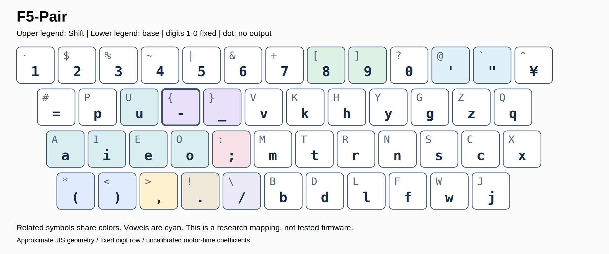
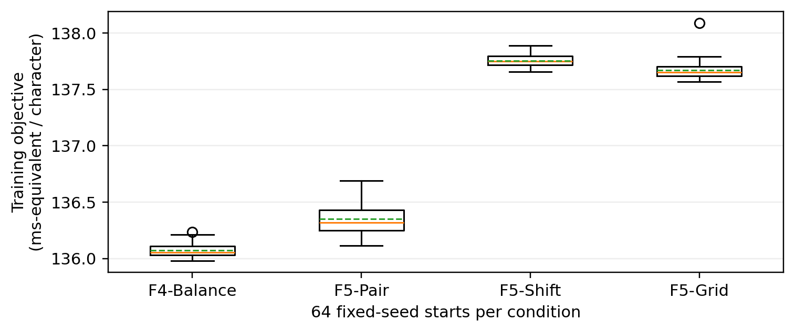

# NOVA F5-Pair: Pair-Constrained Keyboard Layout Optimization for Japanese Romanized Input, English, and Source Code

ks250206

NOVA keyboard-layout project | Research manuscript, version 1.0 | 31 October 2026

## Abstract

Keyboard layouts optimized for movement alone can distribute punctuation in ways that are difficult to memorize. We developed a reproducible computational workflow for Japanese romanized input, English prose, and programming text, culminating in NOVA F5-Pair. A frequency-weighted motor-time surrogate combines same-finger travel, finger-specific row and lateral costs, and explicit opposite-hand Shift actions. Digits remain fixed, shifted letters remain uppercase, and nine punctuation pairs must be adjacent in their prescribed order on one layer or share a base/Shift key. Multi-start simulated annealing evaluated 64 million proposals for unconstrained-symbol F4 experiments and 38.4 million proposals for pair-constrained F5 experiments. Final Japanese inputs were split at sentence level; English and seven programming languages used separate training and test documents or files. F5-Pair yielded modeled speed gains of 16.00%, 15.99%, 10.81%, and 10.61% over the modeled QWERTY-JIS baseline on Japanese test sentences, loanword-rich diagnostic Japanese, English test prose, and held-out code, respectively. The corresponding KLA-main approximation scores were 72.82, 70.64, 72.93, and 62.00. Relative to F4-Balance, the code-time penalty was only 0.154%, while all nine pair constraints were satisfied. F5-Pair was selected for adoption in the GALACTYPE typing-game project as a rule-consistent compromise, not as a proven human-performance optimum. All time coefficients remain uncalibrated; learning, errors, fatigue, IME operations, and developer productivity were not measured. These results support prototype selection and prospective testing, rather than claims of demonstrated typing-speed improvement.

Keywords: keyboard layout; Japanese romanization; simulated annealing; punctuation pairs; Shift modeling; reproducibility

## 1. Introduction

A keyboard layout must serve sequences of actions, not merely place frequent letters near the home row. Japanese romanized input, English prose, and source code place different demands on the same physical device. A Japanese-oriented design can benefit from consonant–vowel alternation, whereas English contains frequent consonant sequences and source code adds brackets, operators, capitalization, and indentation. This study treats these demands jointly while retaining the conventional 1–0 digit order.

Existing alternatives provide useful design baselines. Colemak emphasizes, among other constraints, reduction of same-finger sequences; Workman explicitly discusses directional and lateral reach rather than home-row occupancy alone [5,6]. The Onishi layout separates vowels and consonants and was developed using an Aozora Bunko-derived Japanese corpus [4]. Its published author-side statistics are not directly comparable with the smaller, differently normalized inputs used here. We therefore re-evaluate existing layouts under the same present geometry, character mapping, and objective rather than transfer scores from external websites.

Corpus-based movement optimization and stochastic layout search have precedents in virtual-keyboard research [7]. However, stylus-based movement models are not direct measurements of ten-finger touch typing. Overlapping actions, preparation, skill, and correction behavior limit any simple additive model [3]. Accordingly, we call the present computation a motor-time surrogate and retain a separate KLA-inspired structural score [2]. We do not identify either quantity with observed words per minute.

The central design question is whether explicit rules for related symbols can be imposed without forfeiting most of the efficiency found by free optimization. The contributions are an auditable sequence of design stages, an explicit Shift-aware surrogate, a constrained search over both symbol layers, and a fully specified final candidate. The final adoption decision is a project decision; it does not substitute for an experimental validation of learnability.

## 2. Study design and provenance

### 2.1. Development sequence

The project progressed from small Japanese tasks and distance-based comparisons to bilingual and source-code benchmarks, modern-style Japanese diagnostics, a finger-by-row model, expanded symbol layers, and finally mnemonic pair constraints. Table 1 separates these stages so that early results are not mistaken for directly comparable final-model measurements. The present report is based on repository snapshot ec596b262328ce66629c4f56874dffb364395e7d [1]. The underlying F4/F5 model and fixed candidate layouts were not re-optimized for this manuscript.

Table 1. Development stages and their roles.

| Stage | Design change | Interpretation |
| --- | --- | --- |
| Initial NOVA | Six authored Japanese tasks; bilingual/code tests | Small inputs; distance-oriented |
| Modern diagnostics | Six loanword-rich Japanese tasks | Not a representative population sample |
| Finger–row / F3 | Side-specific row and lateral costs | Uncalibrated subjective priors |
| F4 | Fixed digits, base/Shift symbols, hyphen-side tests | Free symbols and ablations |
| F5 | Hard constraints on nine symbol pairs | Learning benefit not measured |
| This report | Select F5-Pair; audit corpus counts | No candidate or score modification |


The initial benchmark itself used six authored Japanese tasks, not Aozora Bunko. Earlier discussion of Aozora Bunko concerned external motivation and the Onishi baseline. This distinction matters because the initial tasks contained only 10 long-vowel marks in 2,749 romanized input characters (0.364%). A later deliberately loanword-rich set contained 118 such marks in 2,733 characters (4.318%). Neither authored set estimates population-wide Japanese frequencies.

### 2.2. Corpus construction and an audited count correction

The three-domain synthetic corpus was designed from 144 source sentences and assembled into 48 composite documents, totaling 23,483 romanized characters with reuse. Inspection of the documents actually stored in the repository recovers 142 distinct source sentences: two authored sentences were not represented in those composites. The final frozen statistics therefore contain 94 training sentences, 24 validation sentences, and 24 test sentences—not the nominal 96/24/24 previously stated in descriptive material. Character totals and all published numerical scores are unchanged. The correction is derived both from source-sentence identifiers and from the first-character counts in the stored n-gram statistics.

Sentences were divided within topic by source index; this is a deterministic split, not a random sample of contemporary Japanese. The three domains are everyday life, business communication, and technology. The final splits do not share identical sentences, but they share authoring style and topic construction. Earlier composite-document splits reused source sentences and are not treated as independent evidence. Table 2 records the actual final input sizes.

Table 2. Actual document counts / input-character counts in the frozen statistics.

| Domain | Training | Validation | Test / diagnostic |
| --- | --- | --- | --- |
| Everyday JP | 31 / 1,635 | 8 / 442 | 8 / 407 |
| Business JP | 32 / 1,763 | 8 / 446 | 8 / 439 |
| Technical JP | 31 / 1,706 | 8 / 443 | 8 / 455 |
| Japanese total | 94 / 5,104 | 24 / 1,331 | 24 / 1,301 |
| English | 4 / 2,412 | — | 2 / 1,208 |
| Code, 7 languages | 7 / 80,357 | — | 7 / 76,876 |
| Loanword diagnostic | — | — | 6 / 2,733 |

Units are sentences for synthetic Japanese, passages for English, and files for code. The loanword set is a previously inspected diagnostic.

English consists of six authored passages: four for training and two for testing. Final code evaluation covers Python, JavaScript, TypeScript, Go, C, C++, and Java, with one training and one different test file per language. Sources include Requests/CPython, noVNC, MathJax, the Go standard library, Biopython, sharp, and LibreOffice Java examples. Sampling windows and source/sample SHA-256 hashes are archived. An earlier eight-language external check included Rust, but it is distinct from the final seven-language F4/F5 test set and is not pooled into the final scores.

### 2.3. Input representation and information leakage

Japanese is evaluated as fixed romanized input strings, not as displayed kanji/kana characters. The long-vowel mark U+30FC is retained as ASCII hyphen, and a fixed spelling policy uses si/ti/tu/hu/zi with specified extensions for palatalized and loanword sounds. English capitalization and code punctuation are preserved. Supported inputs are printable ASCII, tab, and line feed. Non-supported characters are filtered, and transitions are counted within documents only; no artificial bigram is added between documents. Space, Enter, and Tab remain fixed.

The final Japanese test set has 1,301 input characters; English has 1,208; pooled code has 76,876. These are small or domain-specific samples. The loanword-rich diagnostic set and several other test results had already been inspected during earlier project decisions. Thus, although search candidates were selected using training objectives, these evaluations are not fresh blind tests. The stored validation split is reported for inspection, not used as a separately demonstrated model-selection procedure.

## 3. Computational methods

### 3.1. Physical geometry and action states

The final geometry approximates a staggered JIS keyboard [9]: 13 number-row keys, 12 upper-row keys, 12 home-row keys, and 11 lower-row keys. Row coordinates in key-pitch units are (c−0.5, 2), (c, 1), (c+0.22, 0), and (c+0.47, −1), respectively. These are schematic coordinates, not measurements of the user's device. A pitch of 19.05 mm is used when reporting travel distance. The printed yen key is fixed but outside the ASCII evaluation alphabet. A blank Shift face is not an output character.

Each input character maps to a physical key and a base/Shift layer. Lowercase letters stay on unshifted non-number-row keys and their uppercase equivalents remain on the same shifted key. Digits 1–0 cannot move. All five vowels are constrained to the left hand in newly searched F4/F5 layouts, and the hyphen must remain unshifted. Existing baselines are adapted to the common JIS-like geometry; they are not claimed to be faithful firmware implementations of every original national variant.

### 3.2. Motor-time surrogate

Let u_i, g_ij, f_i, and l_i denote character counts, within-document bigram counts, and document-start and document-end counts. For the action assigned to character i, p(i), the total modeled time is

T = Σᵢ uᵢ C[p(i)] + Σᵢⱼ gᵢⱼ M[p(i),p(j)] + Σᵢ fᵢ B[p(i)] + Σᵢ lᵢ E[p(i)]     (1)

The per-action term includes a 118 ms base interval, a location surcharge, and 8 ms of coordination for a shifted character. For consecutive different keys operated by the same finger, the transition surcharge is 36 + 56 log₂(1+d) + 6d ms, where d is direct key-to-key distance in pitch units. Repeating one physical key costs 23 ms beyond the base interval. For different fingers, the surcharge is 19h_next + 9h_previous ms, plus 8 ms for the same hand, where h is distance from the finger's home key. This is an additive approximation; the reduced return coefficient is not a full simulation of parallel movement.

Table 3. Principal timing parameters (all uncalibrated).

| Term | Value / rule |
| --- | --- |
| Base interval | 118 ms per input character |
| Different-finger reach / return | 19h_next + 9h_previous ms |
| Same hand, different fingers | Additional 8 ms |
| Repeated physical key | Additional 23 ms |
| Same finger, different keys | 36 + 56 log₂(1+d) + 6d ms |
| Number-row action | 12 ms per character |
| Shift coordination / engagement | 8 ms per shifted character; 30 ms + reach per start |
| Pinky / modifier conflict | 12 ms per applicable boundary condition |


The row penalties encode the user's reported discomfort: left pinky/upper +18 ms, left ring/lower +18 ms, left middle/lower +12 ms, right middle/lower +9 ms, right ring/lower +9 ms, and right pinky/upper +7 ms. These are uncalibrated hypotheses, not measured effect sizes. The implementation additionally assigns 12 ms to number-row actions; inward offsets cost 7 ms for index fingers and 5 ms otherwise, and outward offsets cost 10 ms for pinkies and 6 ms otherwise. A same-finger upper-to-lower or lower-to-upper transition adds 7 ms; arrival into inward/outward zones adds 4/6 ms. The zone threshold is a signed horizontal displacement exceeding 0.4 pitch from the finger's home position.

Shift is assigned to the opposite-hand pinky. Starting a Shift run adds 30 ms plus 19 ms per pitch of modifier reach; ending the run adds 9 ms per pitch of return. The same Shift can remain held for adjacent compatible actions. Changing Shift side releases one and engages the other. If a boundary action uses a pinky that conflicts with the neighboring modifier state, a further 12 ms is added per applicable boundary condition. These assumptions account for more than a fixed per-capital surcharge, but still do not represent full multi-finger scheduling, key travel, or variable motor preparation.

### 3.3. Training objective and constraints

For F5-Pair, the training weights are 0.18/0.18/0.19/0.23/0.22 for everyday Japanese, business Japanese, technical Japanese, English, and code. Thus Japanese collectively receives 55%. Each domain is normalized by its input length, and code receives equal weight per training language, rather than weight proportional to file size. Code-heavy and Japanese-heavy variants use the profiles in Table 4.

Table 4. Training weights by optimization profile.

| Profile | Everyday JP | Business JP | Technical JP | English | Code |
| --- | --- | --- | --- | --- | --- |
| JP | 0.3 | 0.3 | 0.25 | 0.08 | 0.07 |
| Balance | 0.18 | 0.18 | 0.19 | 0.23 | 0.22 |
| Code | 0.11 | 0.11 | 0.13 | 0.2 | 0.45 |


The training objective adds soft regularization to normalized motor time: 3 ms-equivalent per non-home-row fraction, 12 per different-key same-finger fraction, 10(L−0.5)² for left-hand use L, and 160Σ_f max(0, ℓ_f−cap_f)² for finger loads. Caps from left pinky through right pinky are 0.12, 0.16, 0.20, 0.28, 0.28, 0.20, 0.16, and 0.12. Thumb use is excluded from that eight-finger regularizer. These terms affect candidate selection, but they are not included in reported motor time or speed gain.

Nine ordered symbol pairs are constrained: parentheses, square brackets, braces, angle brackets, semicolon/colon, single/double quotation marks, comma/period, hyphen/underscore, and slash/backslash. In the mixed condition, each pair must occupy adjacent keys on the same row and layer in the stated left-to-right order, or one physical key with the first member on base and the second on Shift. No cognitive-time bonus is invented. Shift-only variants require all pairs on the same key; Grid variants couple () with <> and [] with {} across two adjacent base/Shift keys, while placing the other pairs on single keys.

### 3.4. Search and independent structural scoring

F4 used ten profile/constraint conditions, 64 starts each, and 100,000 proposals per start. F5 used six conditions at the same per-condition budget. The F5 proposal mixture comprised 48% whole-key swaps, 14% Shift-face swaps, 10% base/Shift symbol exchanges, and 28% pair/block relocations. Feasibility was checked after each move. Except for the initial seed run, starts were randomized by 1,200 feasible-move attempts from a fixed seed layout; these starts are not uniform samples of all feasible layouts.

The annealing temperature decreased geometrically from 1.8 to 0.001 in objective units. An uphill change ΔE was accepted with probability exp(−ΔE/T), followed by descent over the implemented legal neighborhoods. Fixed seeds and restart logs are archived. The search budget is not a count of unique layouts and does not prove global optimality. A separate, restricted enumeration of all 10! = 3,628,800 permutations on the QWERTY digit-row Shift faces supplies an exact optimum only within that restricted subproblem [1,8].

For an independent structural view, we compute KLA-main as a Patorjk-inspired approximation [2]:

KLA-main = 33D + 33U + 17F + 17H                                                    (2)

D = max(0, (4−d̄)/4), with d̄ the modeled main-key travel in cm per input character; U = Σ_f w_f min(100ℓ_f,20)/260; F = max(0, (10−100s_f/N)/10); and H = max(0, (50−100s_h/N)/50). Here s_f and s_h count different-key same-finger and same-hand transitions, excluding thumb hand comparisons as implemented. Finger weights are 0.5/1/4/2/2/4/1/0.5/0.5, including the thumb. The score excludes modifier-pinky motion, even though the time surrogate includes it. It is neither the official web application's direct output nor a validated speed metric. Pooled code KLA is recomputed from pooled counts, not averaged across language scores.

## 4. Results

### 4.1. Final F5-Pair specification

Figure 1 shows the adopted candidate, whose internal identifier is F5-Balance-mixed. Table 5 gives the exact pair relationships. Seven pairs are horizontal neighbors and two share a base/Shift key. In particular, ;/: and slash/backslash share keys; parentheses are neighboring unshifted keys. The hyphen is on upper-row column 4, operated by the left index finger, while underscore occupies the next column. This outcome does not imply that left-hand hyphen placement is universally preferable.



Figure 1. Adopted F5-Pair base and Shift layers. Upper legends show Shift; lower legends show base. Digit positions and uppercase correspondence are retained. This is a mapping specification, not firmware.

Table 5. All nine punctuation relations in F5-Pair.

| Pair | First symbol | Second symbol | Relation |
| --- | --- | --- | --- |
| () | Lower 1 / base | Lower 2 / base | adjacent |
| [] | Number 8 / Shift | Number 9 / Shift | adjacent |
| {} | Upper 4 / Shift | Upper 5 / Shift | adjacent |
| <> | Lower 2 / Shift | Lower 3 / Shift | adjacent |
| ;: | Home 5 / base | Home 5 / Shift | same-key |
| '" | Number 11 / base | Number 12 / base | adjacent |
| ,. | Lower 3 / base | Lower 4 / base | adjacent |
| -_ | Upper 4 / base | Upper 5 / base | adjacent |
| /\ | Lower 5 / base | Lower 5 / Shift | same-key |

Column numbers start at 1 on each physical row.

### 4.2. Modeled time and KLA-main

Table 6 reports comparable final-model speed gains, defined as 100(T_QWERTY/T_layout−1). A 10% speed gain means a time ratio of 1/1.10, not a 10% time saving. F5-Pair reaches 16.00% on Japanese test sentences, 15.99% on loanword-rich Japanese, 10.81% on English, and 10.61% on pooled code. The code time is 149.109 ms per character versus 148.879 ms for F4-Balance: a 0.154% relative time penalty, or approximately 0.230 ms per character. The F4-Balance candidate satisfies none of the nine new strict pair rules, whereas F5-Pair satisfies all nine.

Table 6. Final-model speed gain relative to QWERTY.

| Layout | JP test | Loanword JP | EN test | Code test |
| --- | --- | --- | --- | --- |
| QWERTY | +0.00% | +0.00% | +0.00% | +0.00% |
| Dvorak | +8.19% | +8.76% | +8.90% | +5.13% |
| Colemak | +12.06% | +11.90% | +10.07% | +6.20% |
| Workman | +11.72% | +10.83% | +9.79% | +5.40% |
| Onishi | +14.53% | +14.41% | +8.70% | +5.24% |
| F3-Balance | +15.93% | +15.35% | +10.38% | +6.83% |
| F4-Balance | +16.00% | +16.27% | +10.96% | +10.78% |
| F4-Code | +15.79% | +15.44% | +10.52% | +11.47% |
| F5-Pair | +16.00% | +15.99% | +10.81% | +10.61% |
| F5-Code | +15.88% | +15.76% | +10.41% | +11.12% |
| F5-Shift | +14.84% | +15.20% | +9.45% | +9.02% |
| F5-Grid | +14.78% | +15.14% | +9.42% | +9.33% |
| F5-JP | +18.24% | +17.17% | +6.38% | +7.96% |

The same input and model apply within each column. These are not measured WPM gains.

KLA-main does not reproduce the same ranking (Table 7). F5-Pair scores 72.93 on English and 62.00 on code; F5-Code is slightly higher on code at 62.36. Onishi remains strong on loanword-rich Japanese at 73.22, above F5-Pair at 70.64. Such disagreement is expected because the time surrogate includes finger-specific location and Shift costs, while KLA-main uses a different weighted structure. No single headline score should be interpreted as a universal ranking.

Table 7. KLA-main approximation for principal comparisons.

| Layout | JP test | Loanword JP | EN test | Code test |
| --- | --- | --- | --- | --- |
| QWERTY | 39.16 | 38.02 | 53.25 | 42.07 |
| Dvorak | 49.72 | 50.50 | 68.60 | 53.60 |
| Colemak | 61.05 | 59.10 | 70.68 | 54.53 |
| Workman | 60.85 | 58.23 | 68.76 | 51.69 |
| Onishi | 74.96 | 73.22 | 65.59 | 53.71 |
| F3-Balance | 74.01 | 69.57 | 68.94 | 56.11 |
| F4-Balance | 75.28 | 71.67 | 70.60 | 61.89 |
| F4-Code | 74.49 | 70.94 | 68.64 | 62.32 |
| F5-Pair | 72.82 | 70.64 | 72.93 | 62.00 |
| F5-Code | 72.07 | 68.12 | 69.26 | 62.36 |
| F5-Shift | 75.87 | 72.62 | 66.50 | 61.64 |
| F5-Grid | 72.81 | 68.87 | 68.37 | 61.30 |
| F5-JP | 77.13 | 72.86 | 63.31 | 57.19 |

Modifier-pinky motion is excluded from KLA-main.

Per-language code KLA-main for F5-Pair ranges from 59.76 for C to 63.31 for TypeScript (Table 8). The corpus-level score is not the mean of these seven numbers. Complete 30-layout comparisons are retained in Appendices A and B and in the machine-readable results.

Table 8. Per-language code results for F5-Pair.

| Language | Characters | QWERTY KLA | F5-Pair KLA | Speed gain |
| --- | --- | --- | --- | --- |
| Python | 12,000 | 46.44 | 62.99 | +9.91% |
| JavaScript | 12,000 | 44.13 | 62.93 | +13.64% |
| TypeScript | 12,000 | 42.58 | 63.31 | +8.68% |
| Go | 11,998 | 39.61 | 61.79 | +10.97% |
| C | 12,000 | 38.46 | 59.76 | +9.75% |
| C++ | 12,000 | 41.64 | 60.95 | +9.95% |
| Java | 4,878 | 40.09 | 61.69 | +12.65% |


### 4.3. Long-vowel mark and symbol-layer ablations

In the loanword-rich diagnostic set, all 118 long-vowel marks occur in a vowel–hyphen–consonant sequence. Moving the hyphen from the vowel hand to the consonant hand changes L–L–R into L–R–R, preserving one hand alternation across the two transitions. Thus, the preceding vowel alone is insufficient to determine the best side. With vowels fixed left and whole layouts re-optimized under the Japanese profile, left-hyphen and right-hyphen solutions yield 131.839 and 132.226 ms per character, respectively; KLA-main reverses their order, at 70.14 and 72.13. These are coupled layout comparisons, not isolated causal effects of one key.

In separate F4 ablations, changing only the Shift symbols of F3-Balance raises the code gain from 6.83% to 7.92%; allowing both symbol layers to change with letters fixed raises it to 9.71%. Full F4-Code optimization reaches 11.47%. The corresponding fraction of shifted code characters falls from 13.59% for F3-Balance to 9.31% with both symbol layers optimized. By contrast, exact digit-row Shift-only optimization improves code speed by only about 0.082%. These results locate most of the modeled opportunity in symbol-layer placement, not merely in permuting symbols above fixed digits.

### 4.4. Search behavior and sensitivity

F4 recorded 64,000,000 proposals, 29,373,513 feasible evaluations, and 4,990,936 local-polish evaluations. F5 recorded 38,400,000 proposals, 14,085,600 feasible evaluations, and 1,893,732 polish evaluations. Figure 2 displays restart objective distributions for comparable Balance-profile conditions. Their spread describes stochastic optimization, not participant variability or a confidence interval for human performance. Constrained and unconstrained searches can find different local minima; a constrained run occasionally outperforming a broader search is evidence of finite-search limitations, not a contradiction in the feasible sets.



Figure 2. Results of 64 starts under the Balance training objective. Boxes show interquartile ranges, solid lines medians, dashed lines means, and whiskers extend to observations within 1.5 IQR; outlying starts are shown separately. These are not confidence intervals for human performance.

Across the six archived combinations of row, lateral, and Shift scaling, F5-Pair remains above the corresponding QWERTY baseline: 14.72–17.26% for Japanese test, 10.07–11.56% for English, and 9.60–11.94% for code. These scenario ranges are not statistical uncertainty intervals. They sample only a small set of assumed coefficients and do not establish robustness to all plausible biomechanical models, corpora, or users.

## 5. Discussion and adoption decision

The main outcome is not that F5-Pair maximizes every score. It retains nearly all of the balanced F4 candidate's modeled efficiency while enforcing consistent locations for related symbols. F5-Code is a reasonable alternative when source code dominates; F5-Shift and F5-Grid provide stronger uniformity but require more Shift operations for some common symbols. A reduction in mnemonic complexity is a design rationale, not an observed reduction in learning time.

The project owner selected F5-Pair for the GALACTYPE typing game. This manuscript records that decision and freezes the mapping; it does not claim that game integration, operating-system remapping, or firmware deployment has already been implemented. Implementation should preserve the distinction between physical key events, produced characters, Shift state, and IME composition. A visible base/Shift diagram and pair-based practice tasks can expose the rules without changing the benchmark definition. Shortcut handling and existing QWERTY proficiency require separate decisions because the adopted F5-Pair does not preserve all familiar shortcut positions.

A prospective evaluation should measure inter-keystroke intervals, uncorrected and corrected errors, learning curves, and retention using previously unseen Japanese, English, and code tasks. Within-person comparisons require counterbalanced training and careful treatment of transfer and carryover. The same hardware, input rules, accuracy criteria, and editing environment should be used. Finger/row coefficients should be fitted on training observations and tested on independent sessions; results should be reported separately for novice acquisition and practiced performance. This is a proposed validation program, not part of the completed study.

## 6. Limitations

First, all millisecond coefficients are hypotheses. Finger length, handedness, switches, stagger, posture, reach strategy, and simultaneous movement can alter performance. The additive formulation and its logarithmic same-finger term should not be presented as an experimentally established Fitts-law model of ten-finger typing [3]. Second, synthetic Japanese and short authored English are not representative language samples. Sentence-disjoint splitting removes exact sentence reuse, not stylistic or topic dependence. The deterministic source-index split may introduce additional structure.

Third, code samples include comments, spaces, and indentation; they model transcription rather than editing with completion, auto-pairing, navigation, or reasoning. The final seven-language set does not establish final-model Rust performance. Fourth, previously examined test and diagnostic material weakens claims of independent generalization. We provide descriptive comparisons, not p-values or participant-level confidence intervals. Fifth, pair constraints are only a structural proxy for memorability. Layout search does not quantify fatigue, strain, accessibility, or health benefits. Sixth, no search over the full space was exhaustive; the 10! result applies only to digit-row Shift faces. Finally, existing layouts are evaluated as common-geometry adaptations, so national variants and original implementation conventions remain outside the comparison.

## 7. Reproducibility and conclusion

The pinned repository snapshot [1] contains frozen corpus statistics, full key-layer definitions, candidate seeds, restart histories, score tables, diagrams, and tests. Recalculation for this manuscript reproduced all 768 F4 and 736 F5 layout/group cases without changing the frozen scores. The final adopted identifier is F5-Balance-mixed, displayed as F5-Pair. The input-statistics archive has SHA-256 311a34d5d6c1bc83bc56f83288617877beedee224edc1d06de4c676fc91d7b14. Appendix C provides commands and the complete base/Shift specification.

NOVA F5-Pair demonstrates that pair-consistent punctuation placement can be combined with a small modeled efficiency cost. Its selection is justified as an auditable prototype compromise across Japanese romanized input, English, and code. Human speed, learning, and comfort remain open empirical questions. The appropriate next step is prospective validation, not a claim that a universally best keyboard has been found.

## Declarations

This work reports computational experiments; no human-participant timing, error, physiological, or health measurements were collected. AI assistance was used for corpus generation, code development, analysis support, and manuscript drafting. Synthetic text is explicitly labeled. Source-code bodies from upstream projects are not redistributed in the benchmark archive; source references, hashes, and aggregate counts are provided. The manuscript is a research report, not a peer-reviewed publication. Author affiliation, funding, and conflict-of-interest declarations have not been supplied and must be completed before journal submission.

## References

[1] ks250206. NOVA keyboard-layout research repository. Snapshot ec596b262328ce66629c4f56874dffb364395e7d (31 October 2026). https://github.com/ks250206/keyboard-layout/tree/ec596b262328ce66629c4f56874dffb364395e7d

[2] Patorjk. Keyboard Layout Analyzer; analyzer.js, scoreLayouts implementation. https://patorjk.com/keyboard-layout-analyzer/ ; https://github.com/patorjk/keyboard-layout-analyzer/blob/master/js/analyzer.js (accessed 31 October 2026).

[3] MacKenzie IS. Motor behaviour models for human-computer interaction. In: Carroll JM, editor. HCI Models, Theories, and Frameworks: Toward a Multidisciplinary Science. Morgan Kaufmann; 2003. pp. 27–54. https://www.yorku.ca/mack/mackenzie_chapter.html

[4] Onishi T. ローマ字入力に最適なキー配列を考える（比較編） [Comparing keyboard layouts for Japanese romanized input]. 11 November 2022. https://note.com/illlilllililill/n/nc099239c5565 ; official layout: https://o24.works/layout/ (accessed 31 October 2026).

[5] Coleman S. Colemak: Design. https://colemak.com/Design (accessed 31 October 2026).

[6] Bucao OJ. The Workman Keyboard Layout Philosophy. 6 September 2010. https://workmanlayout.org/ (accessed 31 October 2026).

[7] Zhai S, Hunter M, Smith BA. Performance optimization of virtual keyboards. Human–Computer Interaction. 2002;17(2–3):229–269. doi:10.1080/07370024.2002.9667315.

[8] Kirkpatrick S, Gelatt CD Jr, Vecchi MP. Optimization by simulated annealing. Science. 1983;220(4598):671–680. doi:10.1126/science.220.4598.671.

[9] QMK contributors. Japanese keycode definitions, quantum/keymap_extras/keymap_japanese.h. https://github.com/qmk/qmk_firmware/blob/master/quantum/keymap_extras/keymap_japanese.h (accessed 31 October 2026).


## Appendix A. All-layout KLA-main comparison

All values below are recomputed under the same final F4/F5 geometry and KLA-main approximation. Historical scores calculated under different models must not be substituted. Names are shortened only for display; full identifiers are retained in the CSV. Values are rounded to two decimals, so apparent ties may conceal small numerical differences. Source: results/kla_all.csv at snapshot [1].

Table A1. Aggregate KLA-main scores for all 30 layouts.

| Layout | JP test | Loanword JP | EN test | Code test |
| --- | --- | --- | --- | --- |
| QWERTY | 39.16 | 38.02 | 53.25 | 42.07 |
| Dvorak | 49.72 | 50.50 | 68.60 | 53.60 |
| Colemak | 61.05 | 59.10 | 70.68 | 54.53 |
| Workman | 60.85 | 58.23 | 68.76 | 51.69 |
| Onishi | 74.96 | 73.22 | 65.59 | 53.71 |
| Nova-JP | 77.85 | 71.23 | 62.20 | 52.13 |
| Nova-Hybrid | 72.41 | 66.06 | 67.30 | 56.15 |
| Nova-Dev | 66.32 | 63.24 | 64.44 | 53.35 |
| Nova-Ctrl | 72.27 | 64.30 | 67.42 | 54.74 |
| F3-JP | 77.08 | 72.84 | 66.70 | 53.92 |
| F3-Balance | 74.01 | 69.57 | 68.94 | 56.11 |
| F3-Code | 72.26 | 67.71 | 65.91 | 56.24 |
| F3-Ctrl | 72.31 | 70.23 | 67.01 | 55.52 |
| F4-Balance-free | 74.77 | 71.38 | 68.68 | 61.48 |
| F4-Balance | 75.28 | 71.67 | 70.60 | 61.89 |
| F4-Balance-R | 72.71 | 68.29 | 70.94 | 62.03 |
| F4-Balance-shift-only | 74.01 | 69.57 | 69.02 | 58.86 |
| F4-Balance-symbols-only | 74.01 | 70.64 | 68.31 | 57.54 |
| F4-Code | 74.49 | 70.94 | 68.64 | 62.32 |
| F4-Code-right | 75.79 | 72.05 | 68.79 | 61.67 |
| F4-JP | 74.56 | 69.51 | 63.40 | 58.18 |
| F4-JP-left | 74.72 | 70.14 | 63.63 | 57.78 |
| F4-JP-right | 76.71 | 72.13 | 66.88 | 58.63 |
| QWERTY-ShiftDigitsExact | 39.16 | 38.02 | 53.23 | 41.68 |
| F5-Grid | 72.81 | 68.87 | 68.37 | 61.30 |
| F5-Pair | 72.82 | 70.64 | 72.93 | 62.00 |
| F5-Shift | 75.87 | 72.62 | 66.50 | 61.64 |
| F5-Grid-Code | 74.71 | 71.75 | 65.62 | 60.39 |
| F5-Code | 72.07 | 68.12 | 69.26 | 62.36 |
| F5-JP | 77.13 | 72.86 | 63.31 | 57.19 |


## Appendix B. Domain-specific KLA-main comparisons

These are descriptive scores, not independent replications. Code-language scores are not averaged to form the pooled code score. The full 420-value matrix comprises 30 layouts and 14 evaluation groups.

Table B1. KLA-main scores in three Japanese domains.

| Layout | Everyday JP | Business JP | Technical JP |
| --- | --- | --- | --- |
| QWERTY | 38.98 | 36.96 | 41.45 |
| Dvorak | 50.67 | 45.74 | 52.72 |
| Colemak | 59.62 | 59.45 | 63.63 |
| Workman | 57.92 | 59.74 | 64.49 |
| Onishi | 76.19 | 72.93 | 75.44 |
| Nova-JP | 77.41 | 76.09 | 79.96 |
| Nova-Hybrid | 73.14 | 71.07 | 72.62 |
| Nova-Dev | 66.91 | 65.82 | 66.28 |
| Nova-Ctrl | 73.41 | 70.39 | 73.07 |
| F3-JP | 77.88 | 73.23 | 80.09 |
| F3-Balance | 74.78 | 72.54 | 74.68 |
| F3-Code | 73.30 | 69.96 | 73.55 |
| F3-Ctrl | 73.43 | 69.57 | 73.95 |
| F4-Balance-free | 75.56 | 73.65 | 75.14 |
| F4-Balance | 75.23 | 74.08 | 76.22 |
| F4-Balance-R | 73.14 | 71.67 | 73.06 |
| F4-Balance-shift-only | 74.78 | 72.54 | 74.68 |
| F4-Balance-symbols-only | 74.78 | 72.54 | 74.68 |
| F4-Code | 75.92 | 72.28 | 74.92 |
| F4-Code-right | 76.45 | 74.55 | 76.14 |
| F4-JP | 73.89 | 74.23 | 75.47 |
| F4-JP-left | 73.96 | 74.83 | 75.30 |
| F4-JP-right | 75.58 | 75.63 | 78.75 |
| QWERTY-ShiftDigitsExact | 38.98 | 36.96 | 41.45 |
| F5-Grid | 73.65 | 71.97 | 72.62 |
| F5-Pair | 72.89 | 71.48 | 73.79 |
| F5-Shift | 76.91 | 74.87 | 75.65 |
| F5-Grid-Code | 76.36 | 72.19 | 75.67 |
| F5-Code | 73.19 | 70.11 | 72.94 |
| F5-JP | 76.54 | 75.30 | 79.44 |


### Appendix B continued. Seven code languages

Table B2. KLA-main scores for seven code languages.

| Layout | Python | JS | TS | Go | C | C++ | Java |
| --- | --- | --- | --- | --- | --- | --- | --- |
| QWERTY | 46.44 | 44.13 | 42.58 | 39.61 | 38.46 | 41.64 | 40.09 |
| Dvorak | 54.32 | 56.13 | 56.32 | 52.95 | 47.94 | 51.24 | 59.26 |
| Colemak | 61.21 | 53.95 | 52.28 | 55.42 | 50.02 | 52.87 | 57.14 |
| Workman | 53.23 | 54.45 | 52.86 | 51.81 | 46.12 | 50.66 | 53.17 |
| Onishi | 56.23 | 53.65 | 55.60 | 51.41 | 50.74 | 51.59 | 60.26 |
| Nova-JP | 52.63 | 56.50 | 52.74 | 49.26 | 48.63 | 50.80 | 56.53 |
| Nova-Hybrid | 56.26 | 55.79 | 58.77 | 54.84 | 53.35 | 55.24 | 61.66 |
| Nova-Dev | 54.55 | 55.86 | 53.02 | 52.26 | 49.44 | 52.65 | 58.09 |
| Nova-Ctrl | 55.24 | 56.22 | 56.02 | 53.80 | 51.43 | 53.88 | 58.31 |
| F3-JP | 54.66 | 54.15 | 55.93 | 51.61 | 52.92 | 52.12 | 58.21 |
| F3-Balance | 56.86 | 54.72 | 58.67 | 54.85 | 53.12 | 55.30 | 62.86 |
| F3-Code | 57.68 | 57.10 | 58.16 | 53.96 | 52.65 | 55.49 | 61.25 |
| F3-Ctrl | 58.09 | 56.99 | 56.45 | 53.15 | 52.34 | 54.39 | 58.86 |
| F4-Balance-free | 62.67 | 61.71 | 63.86 | 60.81 | 58.83 | 60.22 | 62.44 |
| F4-Balance | 64.13 | 63.81 | 62.58 | 61.85 | 59.48 | 59.68 | 60.55 |
| F4-Balance-R | 64.15 | 62.74 | 63.36 | 61.20 | 60.02 | 60.28 | 62.25 |
| F4-Balance-shift-only | 59.35 | 58.81 | 61.30 | 57.37 | 55.89 | 58.08 | 63.70 |
| F4-Balance-symbols-only | 56.32 | 57.49 | 60.67 | 57.05 | 54.47 | 56.69 | 62.94 |
| F4-Code | 65.00 | 61.51 | 63.78 | 62.35 | 60.89 | 59.48 | 63.57 |
| F4-Code-right | 62.82 | 61.90 | 64.08 | 61.14 | 58.96 | 60.72 | 61.72 |
| F4-JP | 59.62 | 59.53 | 58.97 | 55.78 | 57.40 | 57.25 | 58.63 |
| F4-JP-left | 59.12 | 59.99 | 57.73 | 56.89 | 56.56 | 56.44 | 56.73 |
| F4-JP-right | 61.26 | 59.55 | 58.65 | 57.81 | 57.14 | 56.10 | 60.94 |
| QWERTY-ShiftDigitsExact | 46.13 | 42.68 | 42.52 | 38.94 | 38.34 | 41.72 | 40.15 |
| F5-Grid | 62.79 | 61.86 | 63.32 | 60.27 | 58.35 | 60.22 | 62.80 |
| F5-Pair | 62.99 | 62.93 | 63.31 | 61.79 | 59.76 | 60.95 | 61.69 |
| F5-Shift | 62.59 | 62.50 | 63.58 | 61.24 | 59.20 | 60.90 | 60.25 |
| F5-Grid-Code | 63.03 | 60.24 | 62.11 | 58.77 | 58.51 | 59.38 | 60.16 |
| F5-Code | 65.13 | 64.10 | 62.68 | 61.72 | 59.59 | 60.11 | 63.45 |
| F5-JP | 59.43 | 59.42 | 57.66 | 55.25 | 55.68 | 55.39 | 56.97 |


## Appendix C. Fixed mapping and reproduction

The table lists each physical row from left to right, including the number row. The symbol ∅ denotes a face with no output; the hyphen character itself remains an ordinary output. The yen legend is outside the evaluated ASCII alphabet. Space, Tab, Enter, and both Shift keys are unchanged. The authoritative implementation-neutral mapping is layouts/f5/full_layers.json, layout F5-Pair.

Table C1. Complete row definitions for base and Shift layers.

| Physical row | Layer | Outputs from left to right |
| --- | --- | --- |
| Number | base | 1 2 3 4 5 6 7 8 9 0 ' " ¥ |
| Number | shift | ∅ $ % ~ \| & + [ ] ? @ ` ^ |
| Upper | base | = p u - _ v k h y g z q |
| Upper | shift | # P U { } V K H Y G Z Q |
| Home | base | a i e o ; m t r n s c x |
| Home | shift | A I E O : M T R N S C X |
| Lower | base | ( ) , . / b d l f w j |
| Lower | shift | * < > ! \ B D L F W J |

∅: no output. ¥: fixed legend outside the evaluated ASCII alphabet.

Recalculate fixed scores without repeating the expensive search:

```bash
git checkout ec596b262328ce66629c4f56874dffb364395e7d
python -m pip install -r requirements-v4.txt
python tools/check_f4.py
python tools/check_f5.py
python -m unittest discover -s tests -p "test_optimize_v[45].py" -v
```

A full search is a separate operation and should be run on a working branch because it regenerates candidates and results. The manuscript build checks recorded source hashes before creating tables. The project corpus audit in this paper corrects only a descriptive sentence count (142 present; 94 training); it does not alter corpus bytes, optimization, or performance values.
