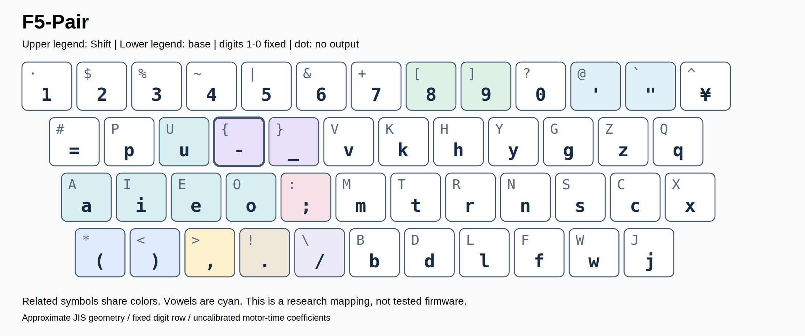
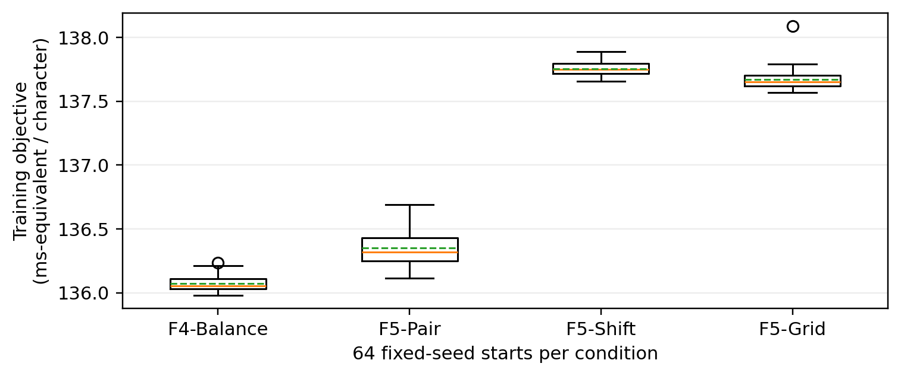

# NOVA F5-Pair：日本語ローマ字・英語・ソースコード入力のための記号ペア制約付きキーボード配列最適化

ks250206

NOVA keyboard-layout project｜研究論文形式の報告書・第1版｜2026年10月31日

## 要旨

指の移動効率だけを最適化したキーボード配列では、関連する記号が離れて配置され、習得時の規則性が失われる場合がある。本研究では、日本語ローマ字入力、英語文章、ソースコードを対象とする再現可能な計算設計を行い、NOVA F5-Pairを得た。評価モデルは同指移動距離、指別の段・内外側コスト、および反対側小指によるShift操作を含む。数字位置と英字の大小対応を固定し、9組の記号を同一段・同一面の左右隣接、または同じキーの通常面／Shift面に配置する制約を課した。多初期値焼きなまし法により、自由記号配置を含むF4で6,400万回、記号ペア制約を導入したF5で3,840万回の変更を提案した。最終評価では日本語を文単位で分離し、英語と7言語のコードには訓練用とは別の文章・ファイルを用いた。F5-PairのQWERTY-JIS近似に対するモデル上の速度増加率は、日本語テスト16.00%、長音符の多い日本語15.99%、英語10.81%、コード10.61%であり、対応するKLA-main近似スコアは72.82、70.64、72.93、62.00であった。F4-Balanceに対するコード所要時間の増加は0.154%にとどまり、9組すべての配置規則を満たした。F5-PairをタイピングゲームGALACTYPEの採用配列に選定したが、これは試作案の選択であり、人間の実測速度、学習時間、誤打鍵、疲労、IME操作、開発生産性の改善を示すものではない。未校正の運動モデルに基づく設計結果を明示し、今後の前向きな実機検証の基盤を提示する。

キーワード：キーボード配列、日本語ローマ字入力、焼きなまし法、記号ペア、Shiftモデル、再現性

## 1．緒言

キーボード配列の設計では、頻出文字をホーム段に置くだけでなく、前後の文字が作る運指を考慮する必要がある。日本語ローマ字入力、英語文章、プログラムのソースコードでは、同じ物理キーに求められる役割が異なる。日本語では子音と母音の交替が重要になる一方、英語には子音連続が多く、コードには括弧、演算子、大文字、インデントが加わる。本研究は、数字1〜0の位置を保持したまま、これらの要求を同時に扱う。

既存配列は設計上の比較対象となる。Colemakは同指連続打鍵の抑制などを重視し、Workmanはホーム段の使用率だけでなく上下・横方向への到達を議論している[5,6]。大西配列は母音と子音を左右に分け、青空文庫由来の文章統計を用いて設計されている[4]。ただし、作者が公表する外部スコアと本研究の小規模コーパスによる値は直接比較できない。本研究では、既存配列を共通のキー座標、文字割当て、評価モデルで再計算した。

文字列統計と運動モデルを組み合わせた確率的な配列設計には、仮想キーボード研究などの先行例がある[7]。一方、スタイラスによる単一指示動作のモデルを、10本の指が重複して動くタッチタイピングへそのまま適用することはできない。動作の重なり、先行準備、習熟、修正操作は単純な加算モデルの限界となる[3]。そこで本研究の時間値を「運動時間の代理モデルによる推定」と位置づけ、Patorjkに基づく構造指標KLA-main近似[2]とは分けて扱う。いずれも実測WPMではない。

本研究の中心的な問いは、自由探索で得た効率を大きく失わずに、関連記号の位置を規則的にできるか、である。設計段階の記録、Shiftを明示した代理モデル、通常面とShift面をまたぐ制約付き探索、および最終候補の完全なキー定義を提示する。タイピングゲームへの採用判断と、習得容易性の実験的証明は区別する。

## 2．研究設計とデータの由来

### 2.1．設計の発展

小規模な日本語課題と移動距離による比較から、日英・コードの横断評価、現代文風の診断課題、指×段モデル、数字・記号面の拡張、記号ペア制約へと設計を進めた。表1に各段階を区別する。初期と最終ではモデルが異なるため、異なる段階の数値を同一尺度の改善量として扱わない。本論文の基準スナップショットはec596b262328ce66629c4f56874dffb364395e7dである[1]。論文化のための再探索や候補の再選択は行っていない。

表1．研究段階と追加した設計要素

| 段階 | 内容 | 解釈上の注意 |
| --- | --- | --- |
| 初期NOVA | 自作日本語6課題、英語・コード比較 | 小規模入力、距離中心 |
| 現代文診断 | 長音符の多い自作6課題 | 代表標本ではない |
| 指×段／F3 | 左右の指、段、内外側コスト | 主観に基づく未校正係数 |
| F4 | 数字固定、通常／Shift面、長音符左右 | 記号自由配置と切り分け |
| F5 | 9記号ペアを位置関係で制約 | 学習時間の効果は未測定 |
| 本報告 | F5-Pairを採用、入力件数を監査 | 配置と既存の数値は変更しない |


初期の日本語ベンチマーク自体は、青空文庫ではなく自作6課題であった。青空文庫への言及は、外部統計や大西配列の設計背景に関するものである。この区別は重要であり、初期課題の長音符は2,749ローマ字入力文字中10回、0.364%にすぎなかった。その後、外来語を意図的に多くした自作6課題を追加し、長音符118回／2,733文字、4.318%の診断集合とした。これらは現代日本語全体の平均頻度を推定する標本ではない。

### 2.2．合成コーパスと件数の監査訂正

生活文・業務文・技術文の3分野について、設計上144個の元文を用意し、その一部を再利用して48文書、計23,483ローマ字入力文字の合成コーパスを作成した。ただし、保存された48文書から実際に復元できる固有の元文は142個であり、設計上の2文は文書に出現していない。したがって、最終の凍結統計に含まれる文数は学習94文、検証24文、テスト24文である。従来の説明にあった96／24／24は名目上の値であった。本論文では元文IDと各文の先頭文字カウントの両方で確認した実使用数に訂正する。文字数、入力統計、保存済みスコアには変更がない。

分割は各トピック内の元文番号に基づく決定的な処理であり、現代日本語からの無作為抽出ではない。最終分割では同一文の重複はないが、生成方針やトピックは共通している。初期の複合文書単位の分割には元文の再利用があったため、独立した検証とはみなさない。最終モデルが使用する入力量を表2に示す。

表2．凍結統計に含まれる実使用文書数と入力文字数

| 分野 | 学習 | 検証 | テスト／診断 |
| --- | --- | --- | --- |
| 生活文 | 31 / 1,635 | 8 / 442 | 8 / 407 |
| 業務文 | 32 / 1,763 | 8 / 446 | 8 / 439 |
| 技術文 | 31 / 1,706 | 8 / 443 | 8 / 455 |
| 日本語計 | 94 / 5,104 | 24 / 1,331 | 24 / 1,301 |
| 英語 | 4 / 2,412 | — | 2 / 1,208 |
| コード7言語 | 7 / 80,357 | — | 7 / 76,876 |
| 長音符診断 | — | — | 6 / 2,733 |

日本語の単位は文、英語は文章、コードはファイル。長音符診断は既出の課題。

英語は自作6課題のうち4課題を学習、2課題をテストに用いた。最終のコード評価はPython、JavaScript、TypeScript、Go、C、C++、Javaの7言語であり、各言語で異なる学習用・テスト用ファイルを使用した。取得元にはRequests／CPython、noVNC、MathJax、Go標準ライブラリ、Biopython、sharp、LibreOfficeのJavaサンプルが含まれる。抽出範囲と元ファイル・抽出文字列のSHA-256を保存した。過去の外部8言語検証にはRustも含まれるが、最終のF4／F5の7言語集合とは別であり、本論文の最終値には混在させない。

### 2.3．入力表現と独立性の範囲

日本語は表示上の漢字かな文字数ではなく、固定した読みとローマ字入力列で評価した。長音符U+30FCはASCIIのハイフンとして保持し、si／ti／tu／hu／ziを基本に、小書きかなや外来語に対する規則を明示した。英語の大文字とコードの記号は保持する。対象は印字可能ASCII、Tab、改行であり、非対応文字は除外した。連続文字は各文書の内部でのみ数え、文書境界をまたぐ架空のバイグラムを生成しない。Space、Enter、Tabは固定する。

最終テスト量は日本語1,301入力文字、英語1,208文字、コード76,876文字である。いずれも小規模または分野限定の標本である。長音符の多い診断課題や一部テスト結果は過去の検討ですでに閲覧している。候補は学習目的関数で選択したものの、最終評価を新規の盲検試験とは位置づけない。保存したvalidation分割は確認用として報告し、独立したモデル選択手順の効果を実証したとは主張しない。

## 3．計算方法

### 3.1．キー座標と入力状態

最終モデルは段差付きJISキーボード[9]の近似であり、数字段13キー、上段12キー、中段12キー、下段11キーを持つ。列番号cに対し、キー間隔を単位とした座標を順に(c−0.5, 2)、(c, 1)、(c+0.22, 0)、(c+0.47, −1)とした。これらは実機の測定値ではなく模式的な座標である。移動距離の換算には19.05 mmのキー間隔を用いる。円記号の表示キーは固定するがASCII評価対象外とし、出力のないShift面は文字として数えない。

各入力文字は物理キーと通常／Shift面の組に対応する。小文字は数字段以外の通常面に配置し、大文字は同じキーのShift面に保持する。数字1〜0は動かさない。新たに探索したF4／F5では母音5文字を左手に制約し、ハイフンは通常面に残す。既存配列は共通JIS近似に適応した比較版であり、各国版や元のファームウェアを完全に再現したものではない。

### 3.2．運動時間の代理モデル

文字数をu_i、文書内のバイグラム数をg_ij、文書先頭・末尾の文字数をf_i、l_i、文字iの入力状態をp(i)とすると、モデル上の合計時間は次式となる。

T = Σᵢ uᵢ C[p(i)] + Σᵢⱼ gᵢⱼ M[p(i),p(j)] + Σᵢ fᵢ B[p(i)] + Σᵢ lᵢ E[p(i)]     (1)

1入力の項には基準118 ms、位置別の追加時間、およびShift文字の協調時間8 msを含める。同じ指で異なるキーを続けて打つ場合の追加時間は36 + 56 log₂(1+d) + 6d msとした。dは前後のキー間距離をキー間隔で表した値である。同じ物理キーの反復は基準時間に23 msを加える。異なる指への遷移では、次の指のホームからの距離h_nextと前のキーからホームへの距離h_previousに対して19h_next + 9h_previous msを加え、同手ならさらに8 msを加える。戻りの係数を小さくしているが、並行動作を完全に時系列で再現するモデルではない。

表3．主な時間係数（すべて未校正）

| 項目 | 値／式 |
| --- | --- |
| 基準入力 | 118 ms/文字 |
| 異指到達・復帰 | 19h_next + 9h_previous ms |
| 同手・異指 | さらに8 ms |
| 同一キー反復 | さらに23 ms |
| 同指・異鍵 | 36 + 56 log₂(1+d) + 6d ms |
| 数字段 | 1文字当たり12 ms |
| Shift協調／開始 | 8 ms/Shift文字；開始30 ms＋到達 |
| 小指と修飾キーの競合 | 該当する境界ごとに12 ms |


段別係数は利用者の主観的な打鍵感覚を仮の値にしたものである。左小指の上段+18 ms、左薬指の下段+18 ms、左中指の下段+12 ms、右中指の下段+9 ms、右薬指の下段+9 ms、右小指の上段+7 msとした。実測された効果量ではない。さらに数字段に12 ms、内側への移動に人差し指7 ms／他指5 ms、外側への移動に小指10 ms／他指6 msを与える。同指の上段・下段間遷移には7 msを加え、到達先が内側／外側なら4／6 msを加える。内外側はホームからの符号付き水平変位が0.4キー間隔を超える場合とする。

Shiftは反対側の小指が担当する。Shift連続区間の開始時には30 msと到達距離×19 ms、終了時には復帰距離×9 msを加える。隣接する入力で同じShiftが使える場合は押し続ける。左右を切り替える場合には解除と開始を計上する。前後の主キーとShift担当小指が競合する境界条件には、それぞれ12 msを加える。一律の大文字加算より詳細ではあるが、複数指の完全な運動計画、スイッチのストローク、先行準備を実装したものではない。

### 3.3．学習目的関数と配置制約

F5-Pairの学習重みは生活文／業務文／技術文／英語／コード＝0.18／0.18／0.19／0.23／0.22であり、日本語全体では55%となる。各分野を文字数で正規化し、コードはファイル長ではなく7言語へ均等に重みを配分する。日本語重視・コード重視の条件も表4に示す。

表4．目的別の学習重み

| 用途 | 生活文 | 業務文 | 技術文 | 英語 | コード |
| --- | --- | --- | --- | --- | --- |
| JP | 0.3 | 0.3 | 0.25 | 0.08 | 0.07 |
| Balance | 0.18 | 0.18 | 0.19 | 0.23 | 0.22 |
| Code | 0.11 | 0.11 | 0.13 | 0.2 | 0.45 |


学習目的関数には、正規化した運動時間に加えて、ホーム段外の割合×3、異鍵同指割合×12、左手割合Lに対する10(L−0.5)²、指負担ℓ_fに対する160Σ_f max(0, ℓ_f−cap_f)²の正則化を加えた。指負担の上限は左小指から右小指へ0.12、0.16、0.20、0.28、0.28、0.20、0.16、0.12であり、親指はこの8指の正則化から除外する。係数の単位はms相当の探索用尺度である。これらは候補選択には影響するが、報告する運動時間・速度増加率には加えない。

対象とする順序付き記号ペアは、丸括弧、角括弧、波括弧、山括弧、セミコロン／コロン、単引用符／二重引用符、カンマ／ピリオド、ハイフン／アンダースコア、スラッシュ／バックスラッシュの9組である。mixed条件では、同じ段・同じ面で指定順に左右隣接させるか、1キーの通常面に第1記号、Shift面に第2記号を配置する。覚えやすさを仮の時間短縮として加算しない。Shift条件は全ペアを同一キーに置き、Grid条件は()と<>、[]と{}を通常／Shift面の2キーのブロックとし、他のペアを同一キーに置く。

### 3.4．探索と独立した構造評価

F4では10条件、F5では6条件を設定し、それぞれ64初期値×10万提案で探索した。F5の提案確率は、キーの通常面・Shift面を一括交換48%、Shift面交換14%、通常／Shift間の記号交換10%、ペアまたはブロックの移動28%である。変更後に制約を検査する。最初の初期値以外は固定した種配置に対する1,200回の合法移動試行で乱数化した。実行可能配置全体からの一様抽出ではない。

焼きなまし温度を目的関数単位で1.8から0.001まで幾何級数的に減少させ、悪化量ΔEの変更を確率exp(−ΔE/T)で受け入れた。その後、実装した合法近傍に対する降下探索を行う。乱数種と再始動ログを保存した。提案数は異なる配列数ではなく、大域最適性を証明しない。別途、QWERTYの数字段Shift面だけを変更する限定問題では10!＝3,628,800通りを全列挙した。この結果が厳密な最適値を与えるのは、その限定した問題だけである[1,8]。

独立した構造指標として、Patorjkを参考にしたKLA-main近似を計算した[2]。

KLA-main = 33D + 33U + 17F + 17H                                                    (2)

D＝max(0, (4−d̄)/4)とし、d̄は入力1文字当たりの主キー移動距離（cm）である。U＝Σ_f w_f min(100ℓ_f,20)/260、F＝max(0, (10−100s_f/N)/10)、H＝max(0, (50−100s_h/N)/50)とする。s_fとs_hは異なる物理キー間の同指・同手遷移数であり、親指の同手判定は実装に従って除外する。指重みは左から0.5／1／4／2／2／4／1／0.5、親指0.5である。この指標はShift小指の移動を除外する一方、時間モデルはそれを含む。公式Webアプリによる直接採点でも、検証済みの速度指標でもない。コード全体のKLAは合算統計から再計算し、言語別点数の単純平均では求めない。

## 4．結果

### 4.1．採用するF5-Pairの定義

図1に最終採用候補を示す。内部IDはF5-Balance-mixedであり、表5に記号の関係を示す。7ペアが左右隣接、2ペアが同一キーの通常／Shift面となった。特にセミコロン／コロンとスラッシュ／バックスラッシュは同じキー、丸括弧は隣接する通常面にある。ハイフンは上段左から4列目の左人差し指、その右隣にアンダースコアを置く。この結果はハイフン左配置の普遍的な優位性を意味しない。



図1．採用するF5-Pairの通常面・Shift面。上の小文字列がShift、下が通常面。数字位置と英字の大小対応を保持する。図は実装定義であり、ファームウェアではない。

表5．F5-Pairの9組の記号関係

| ペア | 第1記号 | 第2記号 | 関係 |
| --- | --- | --- | --- |
| () | 下段 1 / 通常 | 下段 2 / 通常 | 隣接 |
| [] | 数字 8 / Shift | 数字 9 / Shift | 隣接 |
| {} | 上段 4 / Shift | 上段 5 / Shift | 隣接 |
| <> | 下段 2 / Shift | 下段 3 / Shift | 隣接 |
| ;: | 中段 5 / 通常 | 中段 5 / Shift | 同一キー |
| '" | 数字 11 / 通常 | 数字 12 / 通常 | 隣接 |
| ,. | 下段 3 / 通常 | 下段 4 / 通常 | 隣接 |
| -_ | 上段 4 / 通常 | 上段 5 / 通常 | 隣接 |
| /\ | 下段 5 / 通常 | 下段 5 / Shift | 同一キー |

列番号は各物理段の左端を1とする。

### 4.2．運動時間とKLA-main近似

最終モデルによる速度増加率を表6に示す。定義は100(T_QWERTY/T_layout−1)であり、速度+10%は時間比1/1.10を意味し、時間10%削減とは異なる。F5-Pairは日本語テスト+16.00%、長音符の多い日本語+15.99%、英語+10.81%、コード+10.61%であった。コードの時間は149.109 ms/文字で、F4-Balanceの148.879 ms/文字に対して0.154%、約0.230 ms/文字だけ増加した。F4-Balanceが今回の厳密な9ペア規則を0組満たすのに対し、F5-Pairは全9組を満たす。

表6．最終モデルの推定速度増加率（QWERTY比）

| 配列 | 日本語test | 長音符診断 | 英語test | コードtest |
| --- | --- | --- | --- | --- |
| QWERTY | +0.00% | +0.00% | +0.00% | +0.00% |
| Dvorak | +8.19% | +8.76% | +8.90% | +5.13% |
| Colemak | +12.06% | +11.90% | +10.07% | +6.20% |
| Workman | +11.72% | +10.83% | +9.79% | +5.40% |
| 大西 | +14.53% | +14.41% | +8.70% | +5.24% |
| F3-Balance | +15.93% | +15.35% | +10.38% | +6.83% |
| F4-Balance | +16.00% | +16.27% | +10.96% | +10.78% |
| F4-Code | +15.79% | +15.44% | +10.52% | +11.47% |
| F5-Pair | +16.00% | +15.99% | +10.81% | +10.61% |
| F5-Code | +15.88% | +15.76% | +10.41% | +11.12% |
| F5-Shift | +14.84% | +15.20% | +9.45% | +9.02% |
| F5-Grid | +14.78% | +15.14% | +9.42% | +9.33% |
| F5-JP | +18.24% | +17.17% | +6.38% | +7.96% |

各列で同じ文章・モデルを適用。実測WPMではない。

KLA-mainの順位は時間モデルと一致しない（表7）。F5-Pairは英語72.93、コード62.00であり、F5-Codeはコード62.36とわずかに高い。長音符の多い日本語では、大西73.22がF5-Pairの70.64を上回る。時間モデルは指別の位置コストとShiftを含み、KLA-mainは別の重みで構造を評価するため、順位の不一致は不自然ではない。単一の総合点を普遍的な優劣と解釈しない。

表7．主な比較配列のKLA-main近似

| 配列 | 日本語test | 長音符診断 | 英語test | コードtest |
| --- | --- | --- | --- | --- |
| QWERTY | 39.16 | 38.02 | 53.25 | 42.07 |
| Dvorak | 49.72 | 50.50 | 68.60 | 53.60 |
| Colemak | 61.05 | 59.10 | 70.68 | 54.53 |
| Workman | 60.85 | 58.23 | 68.76 | 51.69 |
| 大西 | 74.96 | 73.22 | 65.59 | 53.71 |
| F3-Balance | 74.01 | 69.57 | 68.94 | 56.11 |
| F4-Balance | 75.28 | 71.67 | 70.60 | 61.89 |
| F4-Code | 74.49 | 70.94 | 68.64 | 62.32 |
| F5-Pair | 72.82 | 70.64 | 72.93 | 62.00 |
| F5-Code | 72.07 | 68.12 | 69.26 | 62.36 |
| F5-Shift | 75.87 | 72.62 | 66.50 | 61.64 |
| F5-Grid | 72.81 | 68.87 | 68.37 | 61.30 |
| F5-JP | 77.13 | 72.86 | 63.31 | 57.19 |

Shift小指動作はKLA-mainに含めない。

F5-Pairの言語別コードKLA-mainは、Cの59.76からTypeScriptの63.31まで分布した（表8）。コード全体の値はこの7点の平均ではない。全30配列の一覧を付録A・Bおよび機械可読データに収録した。

表8．F5-Pairの言語別コード評価

| 言語 | 文字数 | QWERTY KLA | F5-Pair KLA | 速度増加 |
| --- | --- | --- | --- | --- |
| Python | 12,000 | 46.44 | 62.99 | +9.91% |
| JavaScript | 12,000 | 44.13 | 62.93 | +13.64% |
| TypeScript | 12,000 | 42.58 | 63.31 | +8.68% |
| Go | 11,998 | 39.61 | 61.79 | +10.97% |
| C | 12,000 | 38.46 | 59.76 | +9.75% |
| C++ | 12,000 | 41.64 | 60.95 | +9.95% |
| Java | 4,878 | 40.09 | 61.69 | +12.65% |


### 4.3．長音符と記号面の切り分け

長音符の多い診断6課題では、118回すべてが母音→ハイフン→子音の列に含まれた。母音左・子音右のとき、ハイフンを左から右へ動かすと左→左→右が左→右→右に変わり、2遷移中の交互打鍵はどちらも1回である。したがって直前の母音だけでは有利な側は決まらない。母音を左に固定し、日本語重視で配列全体を再最適化した比較では、ハイフン左限定131.839 ms/文字、右限定132.226 ms/文字であったが、KLA-mainは70.14対72.13と逆転した。これは複数キーが変わる配列比較であり、ハイフン1キーの独立した因果効果ではない。

F4の切り分けでは、F3-BalanceのShift記号だけを変更するとコード速度増加率が6.83%から7.92%となり、英字を固定して通常／Shift両面の記号を変更すると9.71%、全体を最適化したF4-Codeでは11.47%となった。Shiftを要するコード文字の割合はF3-Balanceの13.59%から両面記号最適化で9.31%へ減少した。一方、数字段Shift面の全列挙最適化によるコード改善は約0.082%にとどまった。今回のモデルでは、数字上の記号の並べ替えだけでなく、記号を通常面に配置できるかが重要であった。

### 4.4．探索のばらつきと感度

F4は6,400万提案、制約を満たす評価29,373,513回、局所改善4,990,936回を記録した。F5は3,840万提案、合法評価14,085,600回、局所改善1,893,732回であった。図2に同じBalance目的関数で比較できる再始動結果を示す。このばらつきは最適化の確率性であり、人間のばらつきや実測性能の信頼区間ではない。制約付き探索が自由度の高い探索より良い局所解を発見する場合もあり、有限探索の取りこぼしを示す。



図2．Balance目的関数における64再始動の結果。箱は四分位範囲、中央線は中央値、破線は平均。ひげは1.5 IQR以内、外側を外れ値として示す。人間の性能の信頼区間ではない。

保存した段・内外側・Shift係数の6組合せで、F5-Pairの対応するQWERTYに対する増加率は日本語テスト14.72〜17.26%、英語10.07〜11.56%、コード9.60〜11.94%であった。これは仮定したシナリオの範囲であり、統計的な不確実性区間ではない。全ての生体運動モデル、コーパス、利用者に対する頑健性を保証しない。

## 5．考察と採用判断

本研究の結論は、F5-Pairがすべての指標を最大化したということではない。関連記号を規則的に配置しながら、バランス型F4のモデル上の効率をほぼ保てた点が重要である。コード中心ならF5-Code、規則の統一をさらに優先するならF5-ShiftやF5-Gridも候補となる。ただし、後者では一部の頻出記号にShiftが必要になる。記憶負担の軽減は設計理由であり、測定された学習時間の改善ではない。

プロジェクト責任者はタイピングゲームGALACTYPEの配列としてF5-Pairを採用する方針を決めた。本論文はその選択と配列定義を記録するものであり、ゲームへの実装、OSリマップ、ファームウェアへの搭載が完了したとは述べない。実装では物理キーイベント、出力文字、Shift状態、IME変換中の入力を区別する必要がある。通常／Shift両面の可視化とペア単位の練習課題は規則を示す方法となるが、評価の入力規則とは分離する。F5-Pairは従来の全ショートカット位置を保持しないため、ショートカット処理とQWERTY技能の移行は別途設計する。

次の実験では、未使用の日本語・英語・コード課題に対し、打鍵間隔、未修正・修正後の誤り、学習曲線、保持を測定するべきである。被験者内比較には練習順序の均衡化と技能転移・持越し効果への対処が必要となる。ハードウェア、入力規則、正確性基準、編集環境を揃え、指×段係数は学習観測から推定して別セッションで検証する。初学者の習得と熟練後の性能は分けて報告する。以上は今後の計画であり、今回実施した実験ではない。

## 6．限界

第一に、全てのミリ秒係数は仮定値である。指長、利き手、スイッチ、段差、姿勢、到達戦略、同時動作により結果は変わり得る。同指移動に対数項を含むからといって、10指タイピングについて実証されたFitts則モデルとはいえない[3]。第二に、合成日本語と短い自作英文は言語全体を代表しない。文単位の分離は同一文の再利用を取り除くが、生成文体やトピックの依存性は残る。元文番号による分割自体にも構造が入り得る。

第三に、コードにはコメント、空白、インデントを含めており、補完、自動括弧、移動、思考を伴う編集ではなく転記を近似する。最終7言語集合からRustでの最終性能は結論できない。第四に、検討途中でテスト結果を閲覧しており、独立した一般化性能の主張には限界がある。記述的比較を提示するもので、p値や被験者に基づく信頼区間は求めていない。第五に、ペア制約は覚えやすさの構造的な代理であり、疲労、障害、アクセシビリティ、健康への利益を測定しない。第六に、全配置空間の探索は全列挙ではなく、10!の厳密解は数字段Shift面に限定される。既存配列は共通座標への適応版であるため、原版の各国仕様や実装慣習も比較範囲外に残る。

## 7．再現性と結論

固定したリポジトリスナップショット[1]には、コーパス統計、全キー両面の定義、初期配置、再始動履歴、スコア表、図、テストを収録した。本論文作成時にF4の768ケースとF5の736ケース、合計1,504ケースを再計算し、凍結スコアとの一致を確認した。採用候補の内部IDはF5-Balance-mixed、表示名はF5-Pairである。入力統計アーカイブのSHA-256は311a34d5d6c1bc83bc56f83288617877beedee224edc1d06de4c676fc91d7b14である。付録Cに実行手順と通常／Shift面を示す。

NOVA F5-Pairは、記号ペアの規則性と小さなモデル上の効率損失を両立できることを示した。日本語ローマ字、英語、コードの複数用途に対する、追跡可能な試作上の妥協点として採用する。人間の速度、学習、快適性は未検証であり、次の段階は前向きな実測である。普遍的に最良の配列を発見したとは結論しない。

## 申告事項

本研究は計算実験であり、被験者の打鍵時間、誤り、生理学的指標、健康指標を収集していない。コーパス生成、コード開発、解析補助、原稿作成にAI支援を利用し、合成文章であることを明示した。上流OSSのソース本文はベンチマークアーカイブに再配布せず、参照先、ハッシュ、集計値を保存している。本稿は未査読の研究報告である。著者所属、研究費、利益相反の情報は本プロジェクトで未入力のため、学術誌投稿時に追記・確認を要する。

## 参考文献

[1] ks250206. NOVA keyboard-layout research repository. Snapshot ec596b262328ce66629c4f56874dffb364395e7d (31 October 2026). https://github.com/ks250206/keyboard-layout/tree/ec596b262328ce66629c4f56874dffb364395e7d

[2] Patorjk. Keyboard Layout Analyzer; analyzer.js, scoreLayouts implementation. https://patorjk.com/keyboard-layout-analyzer/ ; https://github.com/patorjk/keyboard-layout-analyzer/blob/master/js/analyzer.js (accessed 31 October 2026).

[3] MacKenzie IS. Motor behaviour models for human-computer interaction. In: Carroll JM, editor. HCI Models, Theories, and Frameworks: Toward a Multidisciplinary Science. Morgan Kaufmann; 2003. pp. 27–54. https://www.yorku.ca/mack/mackenzie_chapter.html

[4] Onishi T. ローマ字入力に最適なキー配列を考える（比較編） [Comparing keyboard layouts for Japanese romanized input]. 11 November 2022. https://note.com/illlilllililill/n/nc099239c5565 ; official layout: https://o24.works/layout/ (accessed 31 October 2026).

[5] Coleman S. Colemak: Design. https://colemak.com/Design (accessed 31 October 2026).

[6] Bucao OJ. The Workman Keyboard Layout Philosophy. 6 September 2010. https://workmanlayout.org/ (accessed 31 October 2026).

[7] Zhai S, Hunter M, Smith BA. Performance optimization of virtual keyboards. Human–Computer Interaction. 2002;17(2–3):229–269. doi:10.1080/07370024.2002.9667315.

[8] Kirkpatrick S, Gelatt CD Jr, Vecchi MP. Optimization by simulated annealing. Science. 1983;220(4598):671–680. doi:10.1126/science.220.4598.671.

[9] QMK contributors. Japanese keycode definitions, quantum/keymap_extras/keymap_japanese.h. https://github.com/qmk/qmk_firmware/blob/master/quantum/keymap_extras/keymap_japanese.h (accessed 31 October 2026).


## 付録A．全30配列のKLA-main比較

すべて同じ最終F4／F5モデルの座標とKLA-main近似で再計算した値である。異なるモデルによる過去の値と混在させない。表示名を短縮しているが、CSVには完全な内部IDを保持する。小数第2位への丸めで同値に見える場合も、計算値が完全に等しいとは限らない。出典：スナップショット[1]のresults/kla_all.csv。

表A1．全30配列の集約KLA-main近似

| 配列 | 日本語test | 長音符診断 | 英語test | コードtest |
| --- | --- | --- | --- | --- |
| QWERTY | 39.16 | 38.02 | 53.25 | 42.07 |
| Dvorak | 49.72 | 50.50 | 68.60 | 53.60 |
| Colemak | 61.05 | 59.10 | 70.68 | 54.53 |
| Workman | 60.85 | 58.23 | 68.76 | 51.69 |
| 大西 | 74.96 | 73.22 | 65.59 | 53.71 |
| Nova-JP | 77.85 | 71.23 | 62.20 | 52.13 |
| Nova-Hybrid | 72.41 | 66.06 | 67.30 | 56.15 |
| Nova-Dev | 66.32 | 63.24 | 64.44 | 53.35 |
| Nova-Ctrl | 72.27 | 64.30 | 67.42 | 54.74 |
| F3-JP | 77.08 | 72.84 | 66.70 | 53.92 |
| F3-Balance | 74.01 | 69.57 | 68.94 | 56.11 |
| F3-Code | 72.26 | 67.71 | 65.91 | 56.24 |
| F3-Ctrl | 72.31 | 70.23 | 67.01 | 55.52 |
| F4-Balance-free | 74.77 | 71.38 | 68.68 | 61.48 |
| F4-Balance | 75.28 | 71.67 | 70.60 | 61.89 |
| F4-Balance-R | 72.71 | 68.29 | 70.94 | 62.03 |
| F4-Balance-shift-only | 74.01 | 69.57 | 69.02 | 58.86 |
| F4-Balance-symbols-only | 74.01 | 70.64 | 68.31 | 57.54 |
| F4-Code | 74.49 | 70.94 | 68.64 | 62.32 |
| F4-Code-right | 75.79 | 72.05 | 68.79 | 61.67 |
| F4-JP | 74.56 | 69.51 | 63.40 | 58.18 |
| F4-JP-left | 74.72 | 70.14 | 63.63 | 57.78 |
| F4-JP-right | 76.71 | 72.13 | 66.88 | 58.63 |
| QWERTY-ShiftDigitsExact | 39.16 | 38.02 | 53.23 | 41.68 |
| F5-Grid | 72.81 | 68.87 | 68.37 | 61.30 |
| F5-Pair | 72.82 | 70.64 | 72.93 | 62.00 |
| F5-Shift | 75.87 | 72.62 | 66.50 | 61.64 |
| F5-Grid-Code | 74.71 | 71.75 | 65.62 | 60.39 |
| F5-Code | 72.07 | 68.12 | 69.26 | 62.36 |
| F5-JP | 77.13 | 72.86 | 63.31 | 57.19 |


## 付録B．分野別KLA-main比較

各分野の値は記述的な指標であり、独立した追試ではない。コード全体は言語別点数の平均ではない。完全な一覧は30配列×14評価群、計420値から構成される。

表B1．日本語3分野のKLA-main近似

| 配列 | 生活文 | 業務文 | 技術文 |
| --- | --- | --- | --- |
| QWERTY | 38.98 | 36.96 | 41.45 |
| Dvorak | 50.67 | 45.74 | 52.72 |
| Colemak | 59.62 | 59.45 | 63.63 |
| Workman | 57.92 | 59.74 | 64.49 |
| 大西 | 76.19 | 72.93 | 75.44 |
| Nova-JP | 77.41 | 76.09 | 79.96 |
| Nova-Hybrid | 73.14 | 71.07 | 72.62 |
| Nova-Dev | 66.91 | 65.82 | 66.28 |
| Nova-Ctrl | 73.41 | 70.39 | 73.07 |
| F3-JP | 77.88 | 73.23 | 80.09 |
| F3-Balance | 74.78 | 72.54 | 74.68 |
| F3-Code | 73.30 | 69.96 | 73.55 |
| F3-Ctrl | 73.43 | 69.57 | 73.95 |
| F4-Balance-free | 75.56 | 73.65 | 75.14 |
| F4-Balance | 75.23 | 74.08 | 76.22 |
| F4-Balance-R | 73.14 | 71.67 | 73.06 |
| F4-Balance-shift-only | 74.78 | 72.54 | 74.68 |
| F4-Balance-symbols-only | 74.78 | 72.54 | 74.68 |
| F4-Code | 75.92 | 72.28 | 74.92 |
| F4-Code-right | 76.45 | 74.55 | 76.14 |
| F4-JP | 73.89 | 74.23 | 75.47 |
| F4-JP-left | 73.96 | 74.83 | 75.30 |
| F4-JP-right | 75.58 | 75.63 | 78.75 |
| QWERTY-ShiftDigitsExact | 38.98 | 36.96 | 41.45 |
| F5-Grid | 73.65 | 71.97 | 72.62 |
| F5-Pair | 72.89 | 71.48 | 73.79 |
| F5-Shift | 76.91 | 74.87 | 75.65 |
| F5-Grid-Code | 76.36 | 72.19 | 75.67 |
| F5-Code | 73.19 | 70.11 | 72.94 |
| F5-JP | 76.54 | 75.30 | 79.44 |


### 付録B続き：ソースコード7言語

表B2．コード7言語のKLA-main近似

| 配列 | Python | JS | TS | Go | C | C++ | Java |
| --- | --- | --- | --- | --- | --- | --- | --- |
| QWERTY | 46.44 | 44.13 | 42.58 | 39.61 | 38.46 | 41.64 | 40.09 |
| Dvorak | 54.32 | 56.13 | 56.32 | 52.95 | 47.94 | 51.24 | 59.26 |
| Colemak | 61.21 | 53.95 | 52.28 | 55.42 | 50.02 | 52.87 | 57.14 |
| Workman | 53.23 | 54.45 | 52.86 | 51.81 | 46.12 | 50.66 | 53.17 |
| 大西 | 56.23 | 53.65 | 55.60 | 51.41 | 50.74 | 51.59 | 60.26 |
| Nova-JP | 52.63 | 56.50 | 52.74 | 49.26 | 48.63 | 50.80 | 56.53 |
| Nova-Hybrid | 56.26 | 55.79 | 58.77 | 54.84 | 53.35 | 55.24 | 61.66 |
| Nova-Dev | 54.55 | 55.86 | 53.02 | 52.26 | 49.44 | 52.65 | 58.09 |
| Nova-Ctrl | 55.24 | 56.22 | 56.02 | 53.80 | 51.43 | 53.88 | 58.31 |
| F3-JP | 54.66 | 54.15 | 55.93 | 51.61 | 52.92 | 52.12 | 58.21 |
| F3-Balance | 56.86 | 54.72 | 58.67 | 54.85 | 53.12 | 55.30 | 62.86 |
| F3-Code | 57.68 | 57.10 | 58.16 | 53.96 | 52.65 | 55.49 | 61.25 |
| F3-Ctrl | 58.09 | 56.99 | 56.45 | 53.15 | 52.34 | 54.39 | 58.86 |
| F4-Balance-free | 62.67 | 61.71 | 63.86 | 60.81 | 58.83 | 60.22 | 62.44 |
| F4-Balance | 64.13 | 63.81 | 62.58 | 61.85 | 59.48 | 59.68 | 60.55 |
| F4-Balance-R | 64.15 | 62.74 | 63.36 | 61.20 | 60.02 | 60.28 | 62.25 |
| F4-Balance-shift-only | 59.35 | 58.81 | 61.30 | 57.37 | 55.89 | 58.08 | 63.70 |
| F4-Balance-symbols-only | 56.32 | 57.49 | 60.67 | 57.05 | 54.47 | 56.69 | 62.94 |
| F4-Code | 65.00 | 61.51 | 63.78 | 62.35 | 60.89 | 59.48 | 63.57 |
| F4-Code-right | 62.82 | 61.90 | 64.08 | 61.14 | 58.96 | 60.72 | 61.72 |
| F4-JP | 59.62 | 59.53 | 58.97 | 55.78 | 57.40 | 57.25 | 58.63 |
| F4-JP-left | 59.12 | 59.99 | 57.73 | 56.89 | 56.56 | 56.44 | 56.73 |
| F4-JP-right | 61.26 | 59.55 | 58.65 | 57.81 | 57.14 | 56.10 | 60.94 |
| QWERTY-ShiftDigitsExact | 46.13 | 42.68 | 42.52 | 38.94 | 38.34 | 41.72 | 40.15 |
| F5-Grid | 62.79 | 61.86 | 63.32 | 60.27 | 58.35 | 60.22 | 62.80 |
| F5-Pair | 62.99 | 62.93 | 63.31 | 61.79 | 59.76 | 60.95 | 61.69 |
| F5-Shift | 62.59 | 62.50 | 63.58 | 61.24 | 59.20 | 60.90 | 60.25 |
| F5-Grid-Code | 63.03 | 60.24 | 62.11 | 58.77 | 58.51 | 59.38 | 60.16 |
| F5-Code | 65.13 | 64.10 | 62.68 | 61.72 | 59.59 | 60.11 | 63.45 |
| F5-JP | 59.43 | 59.42 | 57.66 | 55.25 | 55.68 | 55.39 | 56.97 |


## 付録C．配列の固定と再計算手順

表は数字段を含め、物理的な各段の左から右へ示す。「∅」は出力がない面を示し、ハイフン文字とは異なる。円記号の表示はASCII評価対象外である。Space、Tab、Enter、左右Shiftは固定する。実装に依存しない正本はlayouts/f5/full_layers.json内のF5-Pairである。

表C1．通常面・Shift面の完全な行定義

| 物理段 | 面 | 左から右への出力 |
| --- | --- | --- |
| 数字段 | 通常 | 1 2 3 4 5 6 7 8 9 0 ' " ¥ |
| 数字段 | Shift | ∅ $ % ~ \| & + [ ] ? @ ` ^ |
| 上段 | 通常 | = p u - _ v k h y g z q |
| 上段 | Shift | # P U { } V K H Y G Z Q |
| 中段 | 通常 | a i e o ; m t r n s c x |
| 中段 | Shift | A I E O : M T R N S C X |
| 下段 | 通常 | ( ) , . / b d l f w j |
| 下段 | Shift | * < > ! \ B D L F W J |

∅：出力なし。¥：固定表示、ASCII評価対象外。

重い探索を繰り返さず、固定結果を再計算する手順は次のとおりである。

```bash
git checkout ec596b262328ce66629c4f56874dffb364395e7d
python -m pip install -r requirements-v4.txt
python tools/check_f4.py
python tools/check_f5.py
python -m unittest discover -s tests -p "test_optimize_v[45].py" -v
```

全探索処理は別の操作であり、候補や結果を再生成するため作業ブランチで行う。本論文のビルドは入力ファイルのハッシュを照合してから表を作成する。今回のコーパス監査は文章数の説明を訂正しただけであり（実在142文、学習94文）、入力バイト列、探索、性能値を変更しない。
